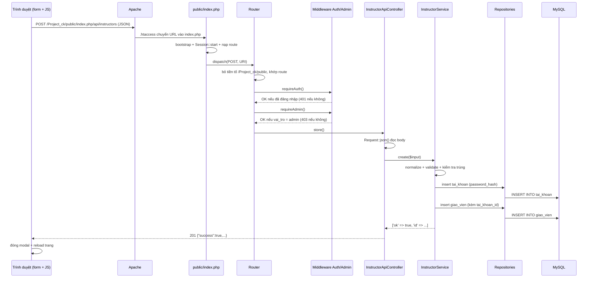

# Luồng hoàn chỉnh: Admin tạo giáo viên

Tài liệu giải thích endpoint `POST /api/instructors` từ đầu đến cuối, dành cho người mới học PHP.

Mục tiêu: admin bấm **Lưu giáo viên** → tạo **2 bản ghi** trong MySQL:

- một tài khoản đăng nhập trong bảng `tai_khoan`
- một hồ sơ giáo viên trong bảng `giao_vien`

Sau đó server trả JSON về trình duyệt, JS đóng modal và tải lại trang.

---

## 1. Sơ đồ tổng quát



Tóm tắt một dòng:

```text
Form → JS fetch → Apache → index.php → Router → middleware
→ Controller → Service → Repository → MySQL
→ Response JSON → JS reload → view đọc lại DB để hiển thị
```

---

## 2. Giao diện: form nằm ở đâu

File: `src/Views/admin/instructors.php`

- Nút mở modal: `data-bs-target="#instructorFormModal"`.
- Modal chứa `<form id="instructor-form">`.
- Các input chính:

| Input | Ý nghĩa |
| --- | --- |
| `#if-name` (`ho_ten`) | Họ tên giáo viên |
| `#if-phone` (`sdt`) | Số điện thoại |
| `#if-email` (`email`) | Email |
| `#if-specialty` (`chuyen_mon`) | Chuyên môn |
| `#if-desc` (`gioi_thieu`) | Giới thiệu |
| `#if-username` (`ten_dang_nhap`) | Tên đăng nhập |
| `#if-password` (`mat_khau`) | Mật khẩu ban đầu |
| `#if-id` (ẩn) | Rỗng = thêm mới, có giá trị = sửa |

HTML không tự gửi form vì JavaScript sẽ chặn và gọi API.

---

## 3. JavaScript: đóng gói dữ liệu và gọi API

File: `public/assets/js/pages/admin-instructors.js`

Khi submit:

```js
form.addEventListener('submit', async function (event) {
    event.preventDefault();               // chặn form tự reload

    const payload = {
        ho_ten: fields.ho_ten.value.trim(),
        sdt: fields.sdt.value.trim(),
        email: fields.email.value.trim(),
        chuyen_mon: fields.chuyen_mon.value.trim(),
        gioi_thieu: fields.gioi_thieu.value.trim(),
        trang_thai: 'dang_lam'
    };

    const id = idInput.value.trim();

    if (id) {
        if (password.value) payload.mat_khau = password.value;
        await window.api.put('/api/instructors/' + id, payload);
    } else {
        payload.ten_dang_nhap = username.value.trim();
        payload.mat_khau = password.value;
        await window.api.post('/api/instructors', payload);
    }

    modal.hide();
    window.location.reload();
});
```

`window.api` được định nghĩa trong `public/assets/js/api.js`:

```js
const config = {
    base: (window.APP_BASE || '') + '/index.php'
};
```

`window.APP_BASE` do layout in ra trong `src/Views/layouts/app.php`:

```php
window.APP_BASE = <?= json_encode(base_url(), JSON_UNESCAPED_SLASHES) ?>;
```

Với dự án này, `base_url()` trả về `/Project_ck/public`, nên URL thực tế là:

```text
POST /Project_ck/public/index.php/api/instructors
```

Hàm `request()` trong `api.js` gọi `fetch(config.base + path, ...)` với:

- `method: 'POST'`
- header `Content-Type: application/json`
- `body: JSON.stringify(payload)`
- `credentials: 'same-origin'` → gửi kèm cookie session để server biết admin đang đăng nhập

---

## 4. Apache và front controller

File: `public/.htaccess`

```apache
RewriteEngine On
RewriteCond %{REQUEST_FILENAME} !-f
RewriteCond %{REQUEST_FILENAME} !-d
RewriteRule ^ index.php [QSA,L]
```

Mọi URL không phải file/thư mục thật đều được đưa vào `public/index.php`.

File: `public/index.php`

```php
require __DIR__ . '/../src/bootstrap.php';   // dòng 25: autoload + helpers
Session::start();                            // dòng 39: mở session
$router = new Router();                      // dòng 42
...
$router->add('POST', '/api/instructors',
    [$instructorController, 'store'],
    [$requireAuth, $requireAdmin]);          // dòng 318
...
$router->dispatch($_SERVER['REQUEST_METHOD'], $_SERVER['REQUEST_URI']); // dòng 324
```

Điểm quan trọng: các route API **chỉ được đăng ký khi kết nối MySQL thành công** (`if ($db !== null)`). Nếu DB sai cấu hình, `POST /api/instructors` sẽ trả 404 vì route không tồn tại.

`bootstrap.php` đăng ký autoloader: class `App\Services\InstructorService` tự động tìm file `src/Services/InstructorService.php`. Nhờ vậy không cần `require` từng class.

---

## 5. Router và middleware

File: `src/Core/Router.php`, hàm `dispatch()`:

```php
$path = parse_url($uri, PHP_URL_PATH) ?? '/';
$base = rtrim(dirname($_SERVER['SCRIPT_NAME']), '/'); // /Project_ck/public

// cắt tiền tố thư mục dự án
// cắt tiếp '/index.php'
// còn lại: /api/instructors
```

Sau đó vòng lặp so khớp method + path:

```php
foreach ($this->routes as [$m, $p, $handler, $middleware]) {
    if ($m !== $method) continue;
    $params = $this->match($p, $path);
    if ($params !== null) {
        foreach ($middleware as $mw) {
            $mw();                        // chạy kiểm tra quyền
        }
        call_user_func($handler, ...$params);
        return;
    }
}
```

Middleware được khai báo trong `public/index.php`:

```php
$requireAuth = function () use ($auth): void {
    if (!$auth->check()) {
        Response::json(['success' => false, 'message' => 'Chưa đăng nhập.'], 401);
    }
};

$requireAdmin = function () use ($auth): void {
    if (!$auth->isAdmin()) {
        Response::json(['success' => false, 'message' => 'Bạn không có quyền thực hiện.'], 403);
    }
};
```

- `Auth::check()` đọc `$_SESSION['tai_khoan_id']`, rồi truy vấn lại bảng `tai_khoan`. Session chỉ giữ id, không giữ quyền → sửa quyền trong DB có hiệu lực ngay.
- `Auth::isAdmin()` kiểm tra `vai_tro === 'admin'`.
- `Response::json()` gọi `exit`, nên middleware dừng request ngay khi chặn.

---

## 6. Controller: chỉ xử lý HTTP

File: `src/Controllers/Api/InstructorApiController.php`

```php
public function store(): void
{
    $this->write('create');
}

private function write(string $operation, ?int $id = null): void
{
    $input = Request::json();                 // đọc body JSON

    try {
        $result = $this->instructorService->create($input);
    } catch (\Throwable $e) {
        error_log('[api/instructors] ' . $e->getMessage());
        Response::json(['success' => false, 'message' => 'Lỗi hệ thống...'], 500);
    }

    if (!$result['ok']) {
        Response::json([
            'success' => false,
            'message' => 'Dữ liệu không hợp lệ.',
            'errors'  => $result['errors'],
        ], 422);
    }

    Response::json([
        'success' => true,
        'message' => 'Đã tạo giáo viên.',
        'data'    => ['id' => $result['id']],
    ], 201);
}
```

`Request::json()` trong `src/Core/Request.php`:

1. Kiểm tra `Content-Type: application/json` (sai → 415).
2. Đọc `php://input`.
3. `json_decode(..., true)` (sai cú pháp → 400).
4. Trả về mảng PHP.

Controller **không** kiểm tra nghiệp vụ, **không** viết SQL. Nó chỉ chuyển dữ liệu vào Service và chuyển kết quả ra JSON.

---

## 7. Service: nghiệp vụ

File: `src/Services/InstructorService.php`, hàm `create()`.

### 7.1 Chuẩn hóa dữ liệu

```php
private function normalize(array $input): array
{
    return [
        'ten_dang_nhap' => trim((string) ($input['ten_dang_nhap'] ?? $input['username'] ?? '')),
        'mat_khau'      => (string) ($input['mat_khau'] ?? $input['password'] ?? ''),
        'ho_ten'        => trim((string) ($input['ho_ten'] ?? $input['name'] ?? '')),
        'chuyen_mon'    => $value === '' ? null : $value,
        'gioi_thieu'    => $value === '' ? null : $value,
        'sdt'           => $phone,
        'email'         => $email,
        'trang_thai'    => trim((string) ($input['trang_thai'] ?? 'dang_lam')),
    ];
}
```

- `??` = nếu key không tồn tại/null thì lấy giá trị mặc định.
- `trim()` bỏ khoảng trắng đầu/cuối.
- `(string)` ép kiểu.
- Hỗ trợ cả key tiếng Anh (`username`, `password`, `name`...) để API linh hoạt.

### 7.2 Validate

```php
$errors = $this->validate($data, true);
```

Kiểm tra:

- `ho_ten` 2–100 ký tự
- `chuyen_mon` ≤ 100
- `sdt` không rỗng, ≤ 15
- `email` đúng định dạng (`filter_var(..., FILTER_VALIDATE_EMAIL)`)
- `trang_thai` chỉ `dang_lam` hoặc `nghi`
- Khi tạo mới: `ten_dang_nhap` 3–50, chỉ chữ/số/`.`/`_`; `mat_khau` 6–72

Nếu có lỗi, Service trả:

```php
return ['ok' => false, 'errors' => $errors];
```

Controller đổi thành HTTP **422** kèm object `errors` để JS hiển thị.

### 7.3 Kiểm tra trùng

```php
if (!$errors && $this->instructorRepository->emailExists($data['email'])) {
    $errors['email'] = 'Email đã được dùng cho giáo viên khác.';
}
if (!$errors && $this->taiKhoanRepository->existsByUsername($data['ten_dang_nhap'])) {
    $errors['ten_dang_nhap'] = 'Tên đăng nhập đã tồn tại.';
}
```

### 7.4 Tạo tài khoản đăng nhập

```php
$taiKhoanId = $this->taiKhoanRepository->insert([
    'ten_dang_nhap' => $data['ten_dang_nhap'],
    'mat_khau'      => password_hash($data['mat_khau'], PASSWORD_DEFAULT),
    'ho_ten'        => $data['ho_ten'],
    'vai_tro'       => 'instructor',
    'trang_thai'    => 1,
]);
```

- `password_hash()` biến mật khẩu thành chuỗi hash một chiều. **Không bao giờ lưu mật khẩu thô.**
- `insert()` là hàm dùng chung ở `BaseRepository`.

### 7.5 Tạo hồ sơ giáo viên

```php
$id = $this->instructorRepository->save(new GiaoVien(
    null,               // id chưa có
    $taiKhoanId,        // liên kết tài khoản vừa tạo
    $data['ho_ten'],
    $data['sdt'],
    $data['email'],
    $data['chuyen_mon'],
    $data['gioi_thieu'],
    $data['trang_thai']
));
```

Nếu bước này lỗi (ví dụ email trùng do race condition), code xóa tài khoản vừa tạo để tránh "tài khoản mồ côi":

```php
} catch (\Throwable $e) {
    $this->taiKhoanRepository->delete($taiKhoanId);
    throw $e;
}
```

Đây là rollback thủ công vì dự án chưa dùng transaction.

---

## 8. Repository và SQL thật

### 8.1 `TaiKhoanRepository` → bảng `tai_khoan`

`insert()` nằm ở `src/Repositories/BaseRepository.php`:

```php
public function insert(array $data): int
{
    $columns      = array_keys($data);
    $colList      = implode(', ', array_map(fn($c) => "`$c`", $columns));
    $placeholders = implode(', ', array_fill(0, count($columns), '?'));

    $sql  = "INSERT INTO `{$this->table}` ($colList) VALUES ($placeholders)";
    $stmt = $this->db->prepare($sql);
    $stmt->bind_param($types, ...$values);
    $stmt->execute();

    return $this->db->insert_id;   // id vừa tạo
}
```

SQL sinh ra:

```sql
INSERT INTO `tai_khoan`
    (`ten_dang_nhap`, `mat_khau`, `ho_ten`, `vai_tro`, `trang_thai`)
VALUES (?, ?, ?, ?, ?)
```

Dùng `?` + `bind_param` = **prepared statement**, chống SQL Injection. Không nối chuỗi dữ liệu người dùng vào SQL.

### 8.2 `InstructorRepository` → bảng `giao_vien`

```php
public function save(GiaoVien $instructor): int
{
    return $this->insert([
        'tai_khoan_id' => $instructor->getTaiKhoanId(),
        'ho_ten'       => $instructor->getHoTen(),
        'sdt'          => $instructor->getSdt(),
        'email'        => $instructor->getEmail(),
        'chuyen_mon'   => $instructor->getChuyenMon(),
        'gioi_thieu'   => $instructor->getGioiThieu(),
        'trang_thai'   => $instructor->getTrangThai(),
    ]);
}
```

Kết quả trong DB sau khi thành công:

```text
tai_khoan:  id=8, ten_dang_nhap='gvabc', mat_khau='$2y$10$...', vai_tro='instructor', trang_thai=1
giao_vien:  id=6, tai_khoan_id=8, ho_ten='...', sdt='...', email='...', trang_thai='dang_lam'
```

Quan hệ: `giao_vien.tai_khoan_id` → `tai_khoan.id`. Nhờ đó khi đăng nhập, hệ thống biết tài khoản này là giáo viên nào (`data_current_instructor()` truy vấn theo `tai_khoan_id`).

---

## 9. Trả JSON và JavaScript xử lý

`src/Core/Response.php`:

```php
public static function json(array $payload, int $status = 200): void
{
    http_response_code($status);
    header('Content-Type: application/json; charset=utf-8');
    header('Cache-Control: no-store');
    echo json_encode($payload, JSON_UNESCAPED_UNICODE);
    exit;
}
```

Thành công:

```json
{
  "success": true,
  "message": "Đã tạo giáo viên.",
  "data": { "id": 6 }
}
```

JavaScript nhận `response.data`, đóng modal, `window.location.reload()`.

Khi trang tải lại, `src/Views/admin/instructors.php` gọi:

```php
$instructors = data_instructors();
```

`data_instructors()` trong `src/Views/data/data.php` chạy:

```sql
SELECT gv.*, tk.ten_dang_nhap
FROM giao_vien gv
LEFT JOIN tai_khoan tk ON tk.id = gv.tai_khoan_id
ORDER BY gv.id
```

Lưu ý: **danh sách hiển thị lấy trực tiếp từ DB khi render trang**, không qua API. API chủ yếu dùng cho modal sửa/xóa (`GET /api/instructors/{id}`, `PUT`, `DELETE`).

---

## 10. Bảng mã lỗi của endpoint

| Mã | Khi nào | Nơi phát sinh |
| --- | --- | --- |
| 201 | Tạo thành công | Controller |
| 400 | Body JSON sai cú pháp | `Request::json()` |
| 401 | Chưa đăng nhập | `$requireAuth` |
| 403 | Đã đăng nhập nhưng không phải admin | `$requireAdmin` |
| 404 | Sai route, hoặc không có DB | `Router::dispatch()` |
| 415 | Content-Type không phải JSON | `Request::json()` |
| 422 | Dữ liệu sai/trùng username/email | `InstructorService::create()` |
| 500 | Lỗi hệ thống/DB | `catch (\Throwable)` trong Controller |

---

## 11. Khái niệm PHP cần biết

- **`namespace App\Services;`**: không gian tên, giống "thư mục logic". `use App\Repositories\...` giống `import`.
- **Autoload**: `bootstrap.php` đăng ký hàm tự nạp; khi gặp `new InstructorService(...)`, PHP tự tìm `src/Services/InstructorService.php`.
- **Constructor property promotion** (PHP 8):

  ```php
  public function __construct(private InstructorService $instructorService) {}
  ```

  Tự tạo property và gán tham số, thay cho khai báo + gán thủ công.

- **Dependency Injection**: `new InstructorService($instructorRepo, $taiKhoanRepo)` — Service không tự `new` repository mà nhận từ bên ngoài. Dễ test/thay thế.
- **Arrow function** `fn ($x) => ...`: hàm ngắn, dùng trong `array_map`/`array_filter`.
- **`??`**: lấy giá trị mặc định nếu biến không tồn tại.
- **`try/catch`**: bắt lỗi để trả JSON thay vì làm trắng trang.
- **`exit`**: dừng script ngay, dùng sau khi đã ghi response.
- **`$_SESSION`**: dữ liệu lưu phía server, trình duyệt chỉ giữ cookie chứa session id.

---

## 12. Tự debug endpoint này

1. Mở DevTools → tab **Network** → bấm lưu.
2. Chọn request `POST .../api/instructors`:
   - **Payload**: kiểm tra JSON gửi lên có `ten_dang_nhap`, `mat_khau` không.
   - **Response**: đọc `success`, `message`, `errors`.
   - **Status**: 201/401/403/422/500.
3. Kiểm tra DB:

   ```sql
   SELECT * FROM tai_khoan ORDER BY id DESC LIMIT 5;
   SELECT * FROM giao_vien ORDER BY id DESC LIMIT 5;
   ```

4. Nếu 500: xem `C:\xampp\apache\logs\error.log` (dòng `[api/instructors] ...`).
5. Nếu 404: kiểm tra đang gọi đúng URL (`/Project_ck/public/index.php/api/instructors`) và MySQL đang chạy.
6. Nếu 401/403: đăng nhập bằng `admin / 123456` trước.

Thử bằng PowerShell (giữ session để giữ đăng nhập):

```powershell
$base = 'http://localhost/Project_ck/public/index.php'
$s = New-Object Microsoft.PowerShell.Commands.WebRequestSession

Invoke-WebRequest -Uri "$base/api/auth/login" -Method POST -WebSession $s `
  -ContentType 'application/json' -Body '{"ten_dang_nhap":"admin","mat_khau":"123456"}'

Invoke-WebRequest -Uri "$base/api/instructors" -Method POST -WebSession $s `
  -ContentType 'application/json' -Body '{
    "ten_dang_nhap":"gvmoi",
    "mat_khau":"123456",
    "ho_ten":"Giáo viên mới",
    "sdt":"0900000000",
    "email":"gvmoi@example.com",
    "chuyen_mon":"Yoga",
    "trang_thai":"dang_lam"
  }'
```

---

## 13. Bản đồ file liên quan

| File | Vai trò |
| --- | --- |
| `src/Views/admin/instructors.php` | Form HTML + hiển thị danh sách |
| `public/assets/js/pages/admin-instructors.js` | Bắt submit, gọi API, xử lý lỗi |
| `public/assets/js/api.js` | Wrapper `fetch`, gắn base URL, xử lý 401/403 |
| `public/.htaccess` | Đưa URL vào front controller |
| `public/index.php` | Bootstrap, session, khai báo route, dispatch |
| `src/Core/Router.php` | Khớp method + path, chạy middleware + handler |
| `src/Core/Request.php` | Đọc và kiểm tra body JSON |
| `src/Core/Response.php` | Trả JSON + status code + `exit` |
| `src/Core/Auth.php` | Kiểm tra đăng nhập/quyền từ session + DB |
| `src/Controllers/Api/InstructorApiController.php` | Nhận request, gọi Service, trả response |
| `src/Services/InstructorService.php` | Validate, kiểm tra trùng, điều phối tạo dữ liệu |
| `src/Repositories/InstructorRepository.php` | SQL cho bảng `giao_vien` |
| `src/Repositories/TaiKhoanRepository.php` | SQL cho bảng `tai_khoan` |
| `src/Repositories/BaseRepository.php` | `insert/update/delete/find` dùng chung |
| `src/Models/GiaoVien.php` | Model giữ dữ liệu giáo viên |
| `src/Views/data/data.php` | Truy vấn dữ liệu để render trang |

---

## 14. Ghi chú thiết kế

- **Controller mỏng, Service dày**: Controller chỉ lo HTTP; nghiệp vụ nằm ở Service.
- **Repository chỉ lo SQL**: đổi CSDL không ảnh hưởng Controller/Service.
- **Không tin dữ liệu client**: mọi kiểm tra quan trọng đều làm lại ở server.
- **Không lưu mật khẩu thô**: dùng `password_hash()`.
- **Không nối chuỗi SQL**: dùng prepared statements.
- **Không lộ lỗi hệ thống**: chỉ trả thông báo chung, chi tiết ghi `error_log`.
- **Session chỉ giữ `tai_khoan_id`**: quyền luôn đọc lại từ DB.

---

# Phụ lục A — Giải thích cú pháp PHP qua chính đoạn code này

Phần này dành cho người **chưa rành PHP**. Mỗi mục giải thích: cú pháp là gì → xuất hiện ở đâu trong dự án → vì sao viết như vậy.

---

## A.1. Một file PHP trông như thế nào

File PHP là file văn bản có đuôi `.php`. Code PHP phải nằm trong cặp thẻ:

```php
<?php
// code PHP ở đây
?>
```

Nếu file chỉ chứa PHP (như `public/index.php`), người ta thường **không đóng** `?>`. Lý do: đóng thẻ rồi vô tình có khoảng trắng/dòng trống phía sau sẽ bị gửi ra trình duyệt, làm lỗi header.

Trong file trộn HTML + PHP (như các view), ta dùng thẻ ngắn để in:

```php
<h1>Xin chào, <?= e($member['ho_ten']) ?></h1>
```

`<?= ... ?>` là viết tắt của `<?php echo ...; ?>`.

**Vì sao code dự án viết vậy:** view là file `.php` nhưng chủ yếu là HTML; chỉ chèn PHP ở chỗ cần in dữ liệu.

---

## A.2. Biến trong PHP

Biến bắt đầu bằng `$`, không cần khai báo kiểu:

```php
$ten = 'Trần Thu Hà';
$tuoi = 30;
$isAdmin = true;
```

So sánh với JS: PHP cũng dùng dấu `;` cuối câu lệnh, nhưng biến **luôn** có `$`.

```php
$router->add(...);   // $router là biến
new Router();        // Router là class, không có $
```

**Lỗi người mới hay gặp:** quên `$` trước tên biến, hoặc viết `$this` thành `this`.

### Chuỗi (string)

```php
$ho = 'Nguyễn';
$ten = "Văn A";
$full = $ho . ' ' . $ten;        // nối chuỗi bằng dấu chấm
$full2 = "$ho $ten";             // nội suy biến trong nháy kép
```

- Nháy đơn `'...'`: lấy nguyên văn, không nội suy biến.
- Nháy kép `"..."`: biến `$ho` được thay bằng giá trị.

Trong code:

```php
"INSERT INTO `{$this->table}` ($colList) VALUES ($placeholders)"
```

`{$this->table}` là nội suy một biểu thức phức tạp (thuộc tính của object), cần cặp `{}`. Nếu chỉ `$colList` thì không cần `{}`.

### Ép kiểu (type cast)

```php
(int) $id
(string) $input['ten_dang_nhap']
```

Ép giá trị sang kiểu mong muốn. Ví dụ `(int) '5'` → số `5`.

Trong `AdminService`:

```php
$id = (int) $account['id'];
```

Vì MySQL trả mọi cột dạng chuỗi (`'5'`), cần ép về số để tính toán/so sánh chặt.

---

## A.3. Mảng (array)

PHP có 2 loại mảng chính.

### Mảng tuần tự (index 0, 1, 2...)

```php
$danhSach = ['admin', 'thuha', 'hoangnam'];
echo $danhSach[0]; // admin
```

### Mảng kết hợp (key => value)

```php
$giaoVien = [
    'ho_ten' => 'Trần Thu Hà',
    'email'  => 'thuha@fitzone.vn',
];

echo $giaoVien['ho_ten'];
```

Mũi tên `=>` nghĩa là "key trỏ tới value". **Phân biệt với `->`** dùng cho object.

Trong code:

```php
$router->add('POST', '/api/instructors', [$controller, 'store'], [$requireAuth]);
```

`[$controller, 'store']` là mảng tuần tự 2 phần tử: object controller và tên method.

### Duyệt mảng

```php
foreach ($accounts as $account) {
    echo $account['ten_dang_nhap'];
}
```

Nếu cần cả key:

```php
foreach ($giaoVien as $key => $value) { ... }
```

### Các hàm mảng hay dùng trong dự án

```php
array_map(fn ($row) => $this->mapRow($row), $rows);  // biến đổi từng phần tử
array_filter($rows, fn ($r) => $r['status'] === 'dang_mo'); // lọc
array_column($rows, 'price');                        // lấy 1 cột
array_sum([1, 2, 3]);                                // 6
array_keys($data);                                   // danh sách key
array_values($data);                                 // danh sách value
implode(', ', ['a', 'b']);                           // "a, b"
array_fill(0, 3, '?');                               // ['?', '?', '?']
```

Ví dụ trong `BaseRepository::insert`:

```php
$columns      = array_keys($data);                                  // ['ten_dang_nhap', 'mat_khau', ...]
$colList      = implode(', ', array_map(fn($c) => "`$c`", $columns)); // "`ten_dang_nhap`, `mat_khau`, ..."
$placeholders = implode(', ', array_fill(0, count($columns), '?')); // "?, ?, ?, ..."
```

Mục đích: sinh câu SQL động theo số cột, nhưng **không** nối giá trị người dùng vào SQL.

---

## A.4. Câu lệnh điều kiện và so sánh

### `if / elseif / else`

```php
if ($length < 6) {
    $errors['mat_khau'] = 'Mật khẩu quá ngắn.';
} elseif ($length > 72) {
    $errors['mat_khau'] = 'Mật khẩu quá dài.';
} else {
    // hợp lệ
}
```

### So sánh `==` và `===`

```php
0 == '0'    // true  (so sánh lỏng, tự đổi kiểu)
0 === '0'   // false (so sánh chặt: khác kiểu)
```

Dự án dùng `===` gần như mọi nơi để tránh bug kiểu dữ liệu:

```php
if ($m !== $method) continue;
if ($r['status'] === 'cho_duyet') { ... }
```

### Toán tử logic

```php
!$auth->check()          // phủ định
$a && $b                 // và
$a || $b                 // hoặc
in_array($x, $arr, true) // có trong mảng không, true = so sánh chặt
```

### Toán tử ba ngôi

```php
$message = $ok ? 'Thành công' : 'Thất bại';
```

### Null coalescing `??`

```php
$ten = $input['ten_dang_nhap'] ?? '';
```

Nghĩa là: nếu `$input['ten_dang_nhap']` tồn tại và khác `null` thì lấy nó, ngược lại lấy `''`. Không gây warning khi key không tồn tại.

### `??` lồng nhau

```php
trim((string) ($input['ten_dang_nhap'] ?? $input['username'] ?? ''))
```

Đọc từ trái sang phải: lấy `ten_dang_nhap`, nếu không có thì lấy `username`, nếu cũng không có thì `''`.

### `match` (PHP 8)

```php
$types .= match (true) {
    is_int($value)   => 'i',
    is_float($value) => 'd',
    default          => 's',
};
```

Giống `switch` nhưng trả về giá trị. Dùng trong `BaseRepository` để chọn kiểu dữ liệu cho `bind_param`.

---

## A.5. Hàm (function)

### Khai báo cơ bản

```php
function tinhTong(int $a, int $b): int
{
    return $a + $b;
}
```

- `int $a`: tham số phải là số nguyên.
- `: int`: hàm trả về số nguyên.
- `return`: trả kết quả và kết thúc hàm.

### Kiểu nullable `?int`

```php
function getById(int $id): ?GiaoVien
```

`?GiaoVien` = trả về `GiaoVien` **hoặc** `null`. Nếu không tìm thấy thì trả `null`.

### Kiểu `void`

```php
public function store(): void
```

Hàm không trả về gì (chỉ gửi response rồi `exit`).

### Tham số mặc định

```php
function data_students_for_class(int $classId = 1, ?string $date = null): array
```

Gọi `data_students_for_class()` thì `$classId = 1`.

### Arrow function `fn`

```php
array_map(fn (GiaoVien $g) => $this->serialize($g), $list);
```

Tương đương:

```php
array_map(function (GiaoVien $g) {
    return $this->serialize($g);
}, $list);
```

`fn` tự động "bắt" biến bên ngoài (như `$this`), ngắn gọn hơn.

### Closure `function () use (...)`

```php
$requireAuth = function () use ($auth): void {
    if (!$auth->check()) {
        Response::json([...], 401);
    }
};
```

Closure là hàm không tên, gán vào biến. `use ($auth)` cần thiết vì closure **không tự thấy** biến bên ngoài (khác arrow function).

### Gọi hàm

```php
$this->validate($data, true);   // method của class
Response::json([...]);          // static method
password_hash($pass);           // hàm toàn cục
```

- `->` gọi method/property của **object**.
- `::` gọi thành phần **static** của class (không cần `new`).

---

## A.6. Class và object (OOP)

### Khai báo class

```php
class InstructorService
{
    public function __construct(
        private InstructorRepository $instructorRepository,
        private TaiKhoanRepository $taiKhoanRepository
    ) {
    }
}
```

Đây là **constructor property promotion** (PHP 8). Nó tương đương với cách viết dài dòng cũ:

```php
class InstructorService
{
    private InstructorRepository $instructorRepository;

    public function __construct(InstructorRepository $instructorRepository)
    {
        $this->instructorRepository = $instructorRepository;
    }
}
```

Tức là: khai báo property + nhận tham số + gán, gộp làm một.

### `new`

```php
$router = new Router();
$service = new InstructorService($instructorRepo, $taiKhoanRepo);
$model = new GiaoVien(null, $taiKhoanId, $hoTen, ...);
```

`new` tạo object từ class, sau đó gọi constructor với các tham số trong ngoặc.

### `$this`

Trong method, `$this` là object hiện tại:

```php
$this->instructorService->create($input);
$this->taiKhoanRepository->insert([...]);
```

### Kế thừa `extends`

```php
class InstructorRepository extends BaseRepository
```

`InstructorRepository` thừa hưởng các method `insert()`, `update()`, `delete()`, `find()`, `count()` từ `BaseRepository`. Nhờ vậy không phải viết lại SQL cơ bản.

`InstructorRepository` chỉ cần khai báo:

```php
protected string $table = 'giao_vien';
```

`BaseRepository::insert()` dùng `$this->table` để biết ghi vào bảng nào.

### `instanceof`

```php
return $instructor instanceof GiaoVien ? $instructor : null;
```

Kiểm tra object có phải class `GiaoVien` không.

### Visibility `public` / `private` / `protected`

- `public`: gọi được từ ngoài.
- `private`: chỉ trong class đó.
- `protected`: trong class và class con.

Ví dụ `private function write()` trong Controller: chỉ dùng nội bộ.

### `static`

```php
public static function json(array $payload, int $status = 200): void
```

Gọi `Response::json(...)` mà không cần `new Response()`. Static method không dùng `$this`.

---

## A.7. Namespace, use và autoload

### `namespace`

```php
namespace App\Services;
```

Khai báo "không gian tên" của file. Class đầy đủ là `App\Services\InstructorService`.

### `use`

```php
use App\Repositories\InstructorRepository;
use App\Repositories\TaiKhoanRepository;
```

Rút gọn tên class, để viết `new InstructorRepository(...)` thay vì `new \App\Repositories\InstructorRepository(...)`.

### Autoload

File `src/bootstrap.php`:

```php
spl_autoload_register(function (string $className): void {
    $prefix  = 'App\\';
    $baseDir = __DIR__ . '/';
    // App\Services\InstructorService -> src/Services/InstructorService.php
    $file = $baseDir . str_replace('\\', '/', substr($className, 4)) . '.php';
    if (is_file($file)) {
        require $file;
    }
});
```

Khi PHP gặp class chưa được nạp, nó gọi hàm này. Hàm đổi tên class thành đường dẫn file rồi `require`.

**Vì sao cần:** không phải viết hàng chục dòng `require` ở đầu mỗi file.

### `__DIR__`

```php
require __DIR__ . '/../src/bootstrap.php';
```

`__DIR__` là thư mục chứa file hiện tại. `..` là lên một cấp.

---

## A.8. Superglobal và HTTP

PHP có các biến toàn cục đặc biệt gọi là superglobal:

```php
$_SERVER['REQUEST_METHOD']   // GET / POST / PUT / DELETE
$_SERVER['REQUEST_URI']      // /Project_ck/public/index.php/api/instructors
$_SERVER['SCRIPT_NAME']      // /Project_ck/public/index.php
$_SERVER['CONTENT_TYPE']     // application/json
$_SESSION['tai_khoan_id']    // id tài khoản đang đăng nhập
$_POST['ho_ten']             // dữ liệu form thường (không dùng cho API JSON)
```

### `header()` và `http_response_code()`

```php
http_response_code(201);
header('Content-Type: application/json; charset=utf-8');
```

- `http_response_code(201)` đặt mã trạng thái HTTP.
- `header(...)` thêm header. Phải gọi **trước khi in nội dung**, nếu không sẽ lỗi "headers already sent".

### `exit`

```php
echo json_encode($payload);
exit;
```

`exit` dừng script ngay lập tức. Trong `Response::json`, sau khi gửi JSON thì không được chạy tiếp code của Controller.

### Đọc body JSON

```php
$raw = file_get_contents('php://input');
$data = json_decode($raw, true, 512, JSON_THROW_ON_ERROR);
```

- `php://input` là luồng dữ liệu thô của request body.
- `json_decode(..., true)` đổi JSON thành mảng kết hợp.
- `JSON_THROW_ON_ERROR` khiến JSON sai cú pháp ném exception thay vì trả `null`.

### `json_encode`

```php
json_encode($payload, JSON_UNESCAPED_UNICODE | JSON_UNESCAPED_SLASHES)
```

Chuyển mảng PHP thành chuỗi JSON. `JSON_UNESCAPED_UNICODE` giữ tiếng Việt dễ đọc (`"Trần"` thay vì `"\u1ea7n"`).

### Hàm xử lý chuỗi hay dùng

```php
trim($s)                 // bỏ khoảng trắng 2 đầu
mb_strlen($s)            // độ dài theo ký tự Unicode (tiếng Việt)
strlen($s)               // độ dài theo byte
filter_var($email, FILTER_VALIDATE_EMAIL)  // kiểm tra email
preg_match('/^[A-Za-z0-9._]+$/', $username) // kiểm tra ký tự hợp lệ
```

### Mật khẩu

```php
password_hash($matKhau, PASSWORD_DEFAULT)  // tạo hash một chiều
password_verify($matKhau, $hash)           // kiểm tra mật khẩu
```

Không thể "giải mã" hash. Khi đăng nhập, ta hash lại mật khẩu người dùng nhập rồi so sánh.

---

## A.9. Exception: `try` / `catch` / `throw`

```php
try {
    $result = $this->instructorService->create($input);
} catch (\Throwable $e) {
    error_log('[api/instructors] ' . $e->getMessage());
    Response::json(['success' => false, 'message' => 'Lỗi hệ thống.'], 500);
}
```

- `try`: chạy code có thể lỗi.
- `catch (\Throwable $e)`: bắt mọi lỗi/exception, biến `$e` chứa thông tin lỗi.
- `\Throwable` có dấu `\` đầu = class toàn cục, tránh nhầm với namespace hiện tại.
- `throw` chủ động ném lỗi:

```php
throw $e;   // ném lại lỗi để tầng trên xử lý
```

**Vì sao code dùng:** lỗi DB không được hiện chi tiết cho người dùng (bảo mật), chỉ ghi log nội bộ.

---

## A.10. MySQLi: prepared statement

### Kết nối

```php
$db = new mysqli($host, $user, $pass, $database, $port);
```

### Câu lệnh có tham số

```php
$stmt = $db->prepare('INSERT INTO tai_khoan (ten_dang_nhap, mat_khau) VALUES (?, ?)');
$stmt->bind_param('ss', $tenDangNhap, $hash);
$stmt->execute();
```

- `?` là chỗ trống cho giá trị.
- `bind_param('ss', ...)`: `s` = string, `i` = integer, `d` = double/float.
- `execute()` chạy câu lệnh.

**Vì sao không nối chuỗi:**

```php
// KHÔNG NÊN
$sql = "SELECT * FROM tai_khoan WHERE ten_dang_nhap = '$username'";
```

Nếu `$username` là `' OR '1'='1` thì SQL bị thay đổi → SQL Injection. Prepared statement tách SQL và dữ liệu, an toàn hơn.

### `bind_param` cần biến, không nhận giá trị trực tiếp

Đây là lỗi thật đã gặp trong dự án:

```php
// SAI: "Argument #2 cannot be passed by reference"
$stmt->bind_param('s', 'hoangnam');
```

`bind_param` nhận tham số **theo tham chiếu** (reference), nên phải truyền biến:

```php
$username = 'hoangnam';
$stmt->bind_param('s', $username);
```

Trong `BaseRepository::insert`, dùng spread `...$values`:

```php
$stmt->bind_param($types, ...$values);
```

Vì `$values` là mảng các biến, spread sẽ truyền từng phần tử — hợp lệ với tham chiếu.

### Lấy kết quả

```php
$result = $stmt->get_result();
$row = $result->fetch_assoc();       // 1 dòng dạng mảng kết hợp, hoặc null
$rows = $result->fetch_all(MYSQLI_ASSOC); // nhiều dòng
```

### Lấy id vừa insert

```php
$id = $db->insert_id;
```

Dùng ngay sau `execute()` của câu `INSERT`.

---

## A.11. Đi qua code thật, từng dòng

### 11.1 Route trong `public/index.php`

```php
$router->add('POST', '/api/instructors', [$instructorController, 'store'], [$requireAuth, $requireAdmin]);
```

- Gọi method `add()` của object `$router`.
- Tham số 1: method HTTP (`'POST'`).
- Tham số 2: đường dẫn (`'/api/instructors'`).
- Tham số 3: mảng callable — object controller + tên method cần gọi.
- Tham số 4: mảng middleware — các hàm chạy trước.

### 11.2 Middleware closure

```php
$requireAuth = function () use ($auth): void {
    if (!$auth->check()) {
        Response::json(['success' => false, 'message' => 'Chưa đăng nhập.'], 401);
    }
};
```

- `$requireAuth` là biến chứa closure.
- `use ($auth)` mang biến `$auth` từ ngoài vào.
- `: void` không trả về gì.
- Nếu chưa đăng nhập, gọi `Response::json()` → hàm này `exit` luôn, nên code phía sau không chạy.

### 11.3 `Router::dispatch`

```php
foreach ($this->routes as [$m, $p, $handler, $middleware]) {
    if ($m !== $method) {
        continue;
    }
    $params = $this->match($p, $path);
    if ($params !== null) {
        foreach ($middleware as $mw) {
            $mw();
        }
        call_user_func($handler, ...$params);
        return;
    }
}
```

- `foreach` + `[$m, $p, ...]` là **destructuring**: lấy 4 phần tử của mảng con gán vào 4 biến.
- `continue` bỏ qua vòng lặp hiện tại.
- `call_user_func($handler, ...$params)`: gọi hàm/callable. Ví dụ `$handler = [$controller, 'store']`.
- `...$params` spread tham số `{id}` vào method.

### 11.4 `Request::json`

```php
$contentType = $_SERVER['CONTENT_TYPE'] ?? '';
if (stripos($contentType, 'application/json') !== 0) {
    Response::json([...], 415);
}
```

- `?? ''`: nếu header không có thì dùng chuỗi rỗng.
- `stripos`: tìm chuỗi con, không phân biệt hoa thường, trả vị trí.
- `!== 0`: không bắt đầu bằng `application/json`.

### 11.5 Controller `write`

```php
$input = Request::json();
$result = $this->instructorService->create($input);
if (!$result['ok']) {
    Response::json([...], 422);
}
Response::json([...], 201);
```

- `$result` là mảng kết quả Service trả về.
- `$result['ok']` là boolean.
- `!$result['ok']` đảo boolean.
- `Response::json()` không trả về gì, nó `exit`.

### 11.6 Service `normalize`

```php
'ho_ten' => trim((string) ($input['ho_ten'] ?? $input['name'] ?? '')),
```

Đọc từ trong ra:

1. `$input['ho_ten']` nếu có, không thì `$input['name']`, không thì `''`.
2. Ép sang string.
3. `trim()` bỏ khoảng trắng.
4. Gán vào key `'ho_ten'`.

### 11.7 Service `validate`

```php
if (mb_strlen($data['ho_ten']) < 2 || mb_strlen($data['ho_ten']) > 100) {
    $errors['ho_ten'] = 'Họ tên giáo viên phải từ 2 đến 100 ký tự.';
}
```

- `||` là hoặc.
- `$errors` là mảng kết hợp: key = tên field, value = thông báo lỗi.
- Chỉ cần 1 điều kiện đúng là gán lỗi.

### 11.8 Service tạo tài khoản

```php
$taiKhoanId = $this->taiKhoanRepository->insert([
    'ten_dang_nhap' => $data['ten_dang_nhap'],
    'mat_khau'      => password_hash($data['mat_khau'], PASSWORD_DEFAULT),
    'ho_ten'        => $data['ho_ten'],
    'vai_tro'       => 'instructor',
    'trang_thai'    => 1,
]);
```

- `insert()` nhận mảng `[cột => giá trị]`.
- `password_hash()` chạy trước khi gán vào mảng.
- Trả về id kiểu `int`, gán cho `$taiKhoanId`.

### 11.9 `BaseRepository::insert`

```php
$columns      = array_keys($data);
$colList      = implode(', ', array_map(fn($c) => "`$c`", $columns));
$placeholders = implode(', ', array_fill(0, count($columns), '?'));
```

Ví dụ `$data = ['ho_ten' => 'A', 'sdt' => '090']`:

- `$columns = ['ho_ten', 'sdt']`
- `$colList = "`ho_ten`, `sdt`"`
- `$placeholders = "?, ?"`

```php
$sql  = "INSERT INTO `{$this->table}` ($colList) VALUES ($placeholders)";
$stmt = $this->db->prepare($sql);
```

SQL cuối:

```sql
INSERT INTO `giao_vien` (`ho_ten`, `sdt`) VALUES (?, ?)
```

```php
$values = array_values($data);        // ['A', '090']
$types  = $this->detectTypes($values); // 'ss'
$stmt->bind_param($types, ...$values); // bind_param('ss', 'A', '090')
$stmt->execute();
```

`detectTypes()` dùng `match` + `is_int`/`is_float` để chọn `i`/`d`/`s`.

### 11.10 `Response::json`

```php
http_response_code($status);
header('Content-Type: application/json; charset=utf-8');
echo json_encode($payload, JSON_UNESCAPED_UNICODE);
exit;
```

- Đặt status code.
- Đặt header JSON.
- In chuỗi JSON.
- Dừng script.

---

## A.12. Những lỗi cú pháp người mới hay gặp

| Lỗi | Sai | Đúng |
| --- | --- | --- |
| Thiếu `$` | `ten = 'A';` | `$ten = 'A';` |
| Thiếu `;` | `echo $ten` | `echo $ten;` |
| Nhầm `=>` và `->` | `$user->'name'` | `$user['name']` hoặc `$obj->name` |
| Nhầm `=` và `==` | `if ($a = 1)` | `if ($a == 1)` / `if ($a === 1)` |
| Key mảng không tồn tại | `$a['x']` khi chưa có | `$a['x'] ?? ''` |
| Nối chuỗi bằng `+` | `'a' + 'b'` | `'a' . 'b'` |
| Dùng `"` mà quên `{}` | `"$obj->name"` | `"{$obj->name}"` |
| Gọi static bằng `->` | `$response->json()` | `Response::json()` |
| Quên `new` | `$r = Router();` | `$r = new Router();` |
| `bind_param` với literal | `bind_param('s', 'abc')` | `$x = 'abc'; bind_param('s', $x)` |

### `=>` và `->` khác nhau thế nào

```php
$arr = ['name' => 'A'];   // => dùng trong mảng
echo $arr['name'];

$obj = new GiaoVien(...); // -> dùng cho object
echo $obj->getHoTen();
```

### `::` dùng khi nào

```php
Response::json([...]);        // static method
GiaoVien::class               // lấy tên class dạng chuỗi
parent::__construct();        // gọi constructor lớp cha
```

---

## A.13. Luồng dữ liệu kiểu (type) trong ví dụ

```text
JSON body (string)
  → json_decode(..., true)  → array PHP
  → normalize()             → array đã trim/ép kiểu
  → validate()              → array lỗi hoặc rỗng
  → insert()                → bind_param + execute
  → MySQL lưu kiểu cột (VARCHAR, INT, ...)
  → fetch_assoc()           → array chuỗi
  → json_encode()           → JSON trả về
```

Hiểu điểm này sẽ hết bối rối "tại sao lúc thì số, lúc thì chuỗi": MySQL trả cột dạng chuỗi, nên view phải ép `(int)` khi cần tính toán.

---

## A.14. Cách đọc một file PHP lạ

1. Đọc `namespace` và `use` → biết file thuộc tầng nào, phụ thuộc class nào.
2. Đọc `class` + `__construct` → biết nó cần những object gì.
3. Đọc các `public function` → đó là API của class.
4. Đọc `private function` → chi tiết nội bộ.
5. Tìm `return` → biết hàm trả gì.
6. Tìm `Response::json`, `header`, `echo` → biết chỗ xuất dữ liệu.
7. Tìm `$db->prepare`, `insert`, `update` → biết chỗ chạm CSDL.

Ví dụ đọc `InstructorApiController`:

- `namespace App\Controllers\Api` → tầng controller API.
- `__construct(private InstructorService $instructorService)` → cần Service.
- `store()` → gọi `write('create')`.
- `write()` → đọc JSON, gọi Service, trả 422/500/201.
- `serialize()` → đổi object thành mảng để trả JSON.

---

## A.15. Bài tập tự kiểm tra

1. Vì sao `$router->add('POST', '/api/instructors', [$controller, 'store'])` dùng mảng thay vì gọi `store()` ngay?
   → Vì route chỉ lưu lại để gọi **sau**, khi request khớp method + path.

2. Vì sao `Response::json()` gọi `exit`?
   → Để dừng script, không cho code phía sau ghi thêm nội dung làm hỏng JSON/header.

3. Vì sao Service trả `['ok' => false, 'errors' => ...]` thay vì ném exception?
   → Lỗi validate là lỗi **dự kiến**, Controller cần đổi thành 422 kèm danh sách lỗi. Exception dành cho lỗi bất ngờ (DB, code).

4. Vì sao phải `password_hash()` trước khi insert?
   → Không lưu mật khẩu thô; nếu DB bị lộ, kẻ tấn công không đọc được mật khẩu gốc.

5. Vì sao `bind_param` cần biến mà không nhận literal?
   → Vì tham số truyền theo reference; literal không có địa chỉ biến để tham chiếu.

6. Vì sao `giao_vien` có cột `tai_khoan_id`?
   → Để nối hồ sơ giáo viên với tài khoản đăng nhập; khi đăng nhập biết được hồ sơ tương ứng.

---

## A.16. Bảng tra nhanh cú pháp

| Cú pháp | Ý nghĩa |
| --- | --- |
| `<?php ... ?>` | Khối code PHP |
| `<?= $x ?>` | In giá trị `$x` |
| `$ten` | Biến |
| `'a' . 'b'` | Nối chuỗi |
| `"$a"` / `"{$obj->x}"` | Nội suy biến |
| `['k' => $v]` | Mảng kết hợp |
| `$a['k']` | Truy cập phần tử mảng |
| `$obj->method()` | Gọi method object |
| `Class::method()` | Gọi static method |
| `new Class(...)` | Tạo object |
| `function f($a): int {}` | Khai báo hàm có kiểu trả về |
| `fn ($x) => $x * 2` | Arrow function |
| `function () use ($a) {}` | Closure bắt biến ngoài |
| `??` | Giá trị mặc định nếu null/không tồn tại |
| `?:` | Ternary rút gọn |
| `===` | So sánh chặt |
| `!` | Phủ định |
| `try/catch` | Bắt lỗi |
| `foreach ($arr as $k => $v)` | Duyệt mảng |
| `array_map` / `array_filter` | Biến đổi / lọc mảng |
| `implode` / `array_fill` | Ghép chuỗi / tạo mảng lặp |
| `header()` / `http_response_code()` | Gửi header / status |
| `exit` | Dừng script |
| `json_decode` / `json_encode` | JSON ↔ mảng PHP |
| `prepare` / `bind_param` / `execute` | Prepared statement |
| `fetch_assoc` | Lấy 1 dòng dạng mảng kết hợp |
| `insert_id` | Id vừa insert |
| `password_hash` / `password_verify` | Hash / kiểm tra mật khẩu |
| `trim` / `mb_strlen` / `filter_var` / `preg_match` | Xử lý/validate chuỗi |
| `__DIR__` | Thư mục file hiện tại |
| `\Throwable` | Class toàn cục (lỗi) |
| `?Type` | Kiểu có thể null |
| `?->` | Gọi method nếu object không null |

---

## A.17. Gợi ý luyện tập

1. Thêm field `ngay_sinh` vào luồng tạo giáo viên:
   - thêm input trong view
   - thêm key trong `payload` JS
   - thêm vào `normalize()`, `validate()`
   - thêm cột DB trong `schema.php` và `insert()` ở `save()`
   - thêm vào `serialize()`
2. Đổi thông báo lỗi trả về thành tiếng Anh.
3. Thêm kiểm tra `sdt` chỉ gồm số bằng `preg_match('/^[0-9]{10,11}$/', $sdt)`.
4. Thử gửi request thiếu `mat_khau` và quan sát response 422.
5. Thử gửi trùng `ten_dang_nhap` để thấy lỗi `errors.ten_dang_nhap`.

Làm được 5 bài này là bạn đã hiểu luồng controller → service → repository của dự án.

---

# Phụ lục B — Từ cú click đến đúng hàm: `.htaccess` và Router lọc route như thế nào

Phần này trả lời đúng câu hỏi: **"Click xong nó đi đâu, tại sao qua `.htaccess`, vào `index.php`, rồi Router biết phải gọi hàm nào? Cú pháp đó lọc bằng cách nào?"**

---

## B.1. Bức tranh tổng quát: có 4 lần "lọc"

```text
[1] Trình duyệt tạo HTTP request
        ↓
[2] Apache nhận URL, đối chiếu file/thư mục thật, dùng .htaccess
        ↓  (rewrite nội bộ, KHÔNG đổi URL trên thanh địa chỉ)
[3] public/index.php nhận request, nạp route, gọi Router::dispatch()
        ↓
[4] Router lọc theo 3 tiêu chí: METHOD + PATH đã chuẩn hóa + từng đoạn URL
        ↓
[5] Gọi đúng Controller::method, sau đó middleware/Service/Repository
```

Mỗi lần lọc chỉ giải quyết một việc nhỏ. Hiểu từng lần là hiểu toàn bộ.

---

## B.2. Lần lọc 1 — Trình duyệt gửi gì?

Khi người dùng bấm một link hoặc JS gọi `fetch`, trình duyệt gửi một **HTTP request** dạng văn bản:

```http
POST /Project_ck/public/index.php/api/instructors HTTP/1.1
Host: localhost
Content-Type: application/json
Cookie: pt_session=abc123

{"ten_dang_nhap":"gvmoi", ...}
```

Ba phần quan trọng:

- **Method**: `POST` (xem trong DevTools → Network → Request Method).
- **Path**: `/Project_ck/public/index.php/api/instructors`.
- **Body**: chuỗi JSON.

Trình duyệt **không biết** PHP, Router, Controller là gì. Nó chỉ gửi URL + method + dữ liệu. Server quyết định xử lý.

---

## B.3. Lần lọc 2 — Apache và `.htaccess`

### Apache tìm file như thế nào

Với URL `/Project_ck/public/index.php/api/instructors`, Apache:

1. DocumentRoot là `C:/xampp/htdocs`.
2. Ghép DocumentRoot + path → `C:/xampp/htdocs/Project_ck/public/index.php/api/instructors`.
3. Phần `/index.php` là file có thật; phần `/api/instructors` phía sau gọi là **PATH_INFO** (đường dẫn phụ).
4. Apache thấy `index.php` là file PHP → chạy nó, đồng thời đặt các biến `$_SERVER` (PATH_INFO có thể có nếu `AcceptPathInfo` bật; Router không phụ thuộc vào nó):

```php
$_SERVER['SCRIPT_NAME']  = '/Project_ck/public/index.php';
$_SERVER['REQUEST_URI']  = '/Project_ck/public/index.php/api/instructors';
$_SERVER['PHP_SELF']     = '/Project_ck/public/index.php/api/instructors';
$_SERVER['PATH_INFO']    = '/api/instructors';
$_SERVER['REQUEST_METHOD'] = 'POST';
```

**Điểm mấu chốt:** PHP không tự biết URL đẹp. Nó chỉ thấy các biến `$_SERVER` do Apache đặt.

### Khi URL là "đường dẫn đẹp"

Ví dụ người dùng mở:

```text
http://localhost/Project_ck/public/admin/instructors
```

Apache ghép thành:

```text
C:/xampp/htdocs/Project_ck/public/admin/instructors
```

Không có file/thư mục nào tên `admin/instructors`. Lúc này `.htaccess` trong `public/` phát huy tác dụng.

File `public/.htaccess`:

```apache
RewriteEngine On

# Nếu file/thư mục không tồn tại thật thì đưa hết vào index.php
RewriteCond %{REQUEST_FILENAME} !-f
RewriteCond %{REQUEST_FILENAME} !-d
RewriteRule ^ index.php [QSA,L]
```

Giải thích từng dòng:

| Cú pháp | Ý nghĩa |
| --- | --- |
| `RewriteEngine On` | Bật module rewrite cho thư mục này |
| `%{REQUEST_FILENAME}` | Đường dẫn file thật Apache đang xét |
| `!-f` | "không phải file tồn tại" |
| `!-d` | "không phải thư mục tồn tại" |
| `RewriteRule ^ index.php` | Nếu khớp (mọi URL), thay bằng `index.php` |
| `[QSA]` | Query String Append: giữ `?a=1&b=2` phía sau |
| `[L]` | Last: dừng xử lý các rule rewrite tiếp theo |

Vì `admin/instructors` không phải file/thư mục thật, Apache **rewrite nội bộ** URL thành:

```text
/Project_ck/public/index.php
```

Lúc này PHP nhận:

```php
$_SERVER['SCRIPT_NAME'] = '/Project_ck/public/index.php';
$_SERVER['REQUEST_URI'] = '/Project_ck/public/admin/instructors'; // URL gốc vẫn giữ
$_SERVER['REQUEST_METHOD'] = 'GET';
```

### Rewrite nội bộ khác Redirect

- **Rewrite nội bộ**: server đổi file sẽ chạy, trình duyệt **không biết**, URL trên thanh địa chỉ không đổi.
- **Redirect 301/302**: server bảo trình duyệt "hãy gọi URL khác", trình duyệt đổi URL.

`.htaccess` ở đây dùng rewrite nội bộ, nên người dùng vẫn thấy `/admin/instructors`.

### Vì sao đôi khi `.htaccess` không có tác dụng

- Apache chưa bật `mod_rewrite`.
- Thư mục chưa cho phép `AllowOverride` (thường cần `AllowOverride All`).
- Đặt `.htaccess` sai thư mục (phải nằm trong `public/`, nơi chứa `index.php`).
- URL gọi sai DocumentRoot (ví dụ `/index.php/...` khi `index.php` không nằm ở gốc `htdocs`).

Đây chính là lý do trước đó gọi `http://localhost/index.php/api/...` bị 404: `htdocs/index.php` không tồn tại.

### `.htaccess` phụ ở gốc `htdocs`

Dự án còn một file ngoài repo: `C:\xampp\htdocs\.htaccess`

```apache
RewriteEngine On

RewriteRule ^api(/.*)?$ Project_ck/public/index.php [L,QSA]
RewriteRule ^index\.php(/.*)?$ Project_ck/public/index.php [L,QSA]
```

Nó cho phép gọi tắt:

```text
http://localhost/api/instructors
http://localhost/index.php/api/instructors
```

thay vì URL đầy đủ có `/Project_ck/public`.

Lúc này PHP nhận:

```php
$_SERVER['SCRIPT_NAME'] = '/Project_ck/public/index.php';
$_SERVER['REQUEST_URI'] = '/api/instructors';   // hoặc '/index.php/api/instructors'
```

Router sẽ xử lý phần chuẩn hóa path ở bước sau.

---

## B.4. Lần lọc 3 — `public/index.php` nạp route

File `public/index.php` chạy từ trên xuống:

```php
require __DIR__ . '/../src/bootstrap.php';   // 1. autoload + helpers
Session::start();                            // 2. mở session (đọc cookie pt_session)
$router = new Router();                      // 3. tạo object Router rỗng

$router->add('GET',  '/admin/instructors', function () { ... });
$router->add('POST', '/api/instructors',
    [$instructorController, 'store'],
    [$requireAuth, $requireAdmin]);          // 4. đăng ký route
...
$router->dispatch($_SERVER['REQUEST_METHOD'], $_SERVER['REQUEST_URI']); // 5. chạy
```

### `$router->add(...)` thực chất làm gì?

Trong `src/Core/Router.php`:

```php
private array $routes = [];

public function add(string $method, string $path, callable $handler, array $middleware = []): void
{
    $this->routes[] = [$method, $path, $handler, $middleware];
}
```

Mỗi lần `add()` chỉ **thêm một phần tử** vào mảng `$routes`. Ví dụ sau khi nạp:

```php
$routes = [
    ['GET',  '/admin/instructors', callable_A, []],
    ['POST', '/api/instructors',   [$instructorController, 'store'], [$requireAuth, $requireAdmin]],
    ['GET',  '/api/instructors',   [$instructorController, 'index'], [$requireAuth]],
    ['GET',  '/api/instructors/{id}', [$instructorController, 'show'], [$requireAuth]],
    ...
];
```

Đây là lý do phải dùng `[$controller, 'method']`: **route chỉ lưu tên method**, chưa gọi. Khi request khớp mới gọi. Nếu gọi `$controller->store()` ngay lúc khai báo, nó sẽ chạy mỗi lần tải file, sai hoàn toàn.

### Vì sao có `callable` trong khai báo?

```php
public function add(string $method, string $path, callable $handler, ...)
```

`callable` là kiểu "có thể gọi được": hàm, closure, hoặc mảng `[object, 'method']`. PHP sẽ kiểm tra khi truyền vào.

- Closure: `function () { ... }`
- Mảng object + method: `[$instructorController, 'store']`
- Tên hàm dạng chuỗi: `'myFunction'`

---

## B.5. Lần lọc 4 — `Router::dispatch()` lọc route

Đây là phần "phân loại route" mà bạn hỏi. Code thật:

```php
public function dispatch(string $method, string $uri): void
{
    $path = parse_url($uri, PHP_URL_PATH) ?? '/';

    $base = rtrim(str_replace('\\', '/', dirname($_SERVER['SCRIPT_NAME'] ?? '')), '/');
    if ($base !== '' && strncmp($path, $base, strlen($base)) === 0) {
        $path = substr($path, strlen($base));
    }
    if (strncmp($path, '/index.php', 10) === 0) {
        $path = substr($path, 10);
    }
    if ($path === '') {
        $path = '/';
    }

    foreach ($this->routes as [$m, $p, $handler, $middleware]) {
        if ($m !== $method) {
            continue;
        }
        $params = $this->match($p, $path);
        if ($params !== null) {
            foreach ($middleware as $mw) {
                $mw();
            }
            call_user_func($handler, ...$params);
            return;
        }
    }

    http_response_code(404);
    // ... trả JSON hoặc HTML
}
```

Ta bóc từng bước.

---

### B.5.1. `parse_url($uri, PHP_URL_PATH)` — bỏ query string

```php
$uri  = '/Project_ck/public/index.php/api/instructors?page=2';
$path = parse_url($uri, PHP_URL_PATH);
// $path = '/Project_ck/public/index.php/api/instructors'
```

- `parse_url` tách URL thành các phần: scheme, host, path, query...
- `PHP_URL_PATH` yêu cầu chỉ lấy phần path.
- `?? '/'` phòng trường hợp `parse_url` trả `null`.

**Vì sao cần:** route chỉ so khớp đường dẫn, không quan tâm `?page=2`.

---

### B.5.2. Tính `$base` — tiền tố thư mục dự án

```php
$base = rtrim(str_replace('\\', '/', dirname($_SERVER['SCRIPT_NAME'] ?? '')), '/');
```

Ví dụ `$_SERVER['SCRIPT_NAME'] = '/Project_ck/public/index.php'`:

1. `dirname('/Project_ck/public/index.php')` → `'/Project_ck/public'`.
2. `str_replace('\\', '/', ...)` đổi `\` thành `/` (Windows).
3. `rtrim(..., '/')` bỏ `/` ở cuối (nếu có), tránh `//`.

Kết quả:

```php
$base = '/Project_ck/public';
```

Nếu chạy bằng PHP built-in server với DocumentRoot là `public`, `SCRIPT_NAME` có thể là `/index.php`, khi đó:

```php
$base = '';   // dirname('/index.php') = '/', rtrim('/') = ''
```

---

### B.5.3. Cắt tiền tố bằng `strncmp` + `substr`

```php
if ($base !== '' && strncmp($path, $base, strlen($base)) === 0) {
    $path = substr($path, strlen($base));
}
```

- `strncmp($a, $b, $n)`: so sánh `$n` ký tự đầu của 2 chuỗi. Trả `0` nếu giống.
- `strlen($base)`: độ dài tiền tố.
- `substr($path, $n)`: lấy chuỗi từ vị trí `$n`.

Ví dụ:

```text
$path = '/Project_ck/public/index.php/api/instructors'
$base = '/Project_ck/public'  (dài 17)
strncmp(...) === 0  → đúng
substr($path, 17)   → '/index.php/api/instructors'
```

**Vì sao cần:** URL chứa tên thư mục dự án. Route khai báo là `/api/instructors`, không phải `/Project_ck/public/api/instructors`.

Nếu request là `http://localhost/api/instructors` (nhờ `.htaccess` gốc), `$path = '/api/instructors'` không bắt đầu bằng `$base`, nên không cắt. Đúng.

---

### B.5.4. Cắt `/index.php` bằng `strncmp` 10 ký tự

```php
if (strncmp($path, '/index.php', 10) === 0) {
    $path = substr($path, 10);
}
```

`'/index.php'` dài đúng 10 ký tự:

```text
/ i n d e x . p h p
1 2 3 4 5 6 7 8 9 10
```

Ví dụ:

```text
$path = '/index.php/api/instructors'
substr($path, 10) = '/api/instructors'
```

**Vì sao cần:** khi client gọi trực tiếp `.../index.php/api/instructors`, `REQUEST_URI` chứa `/index.php`. Route khai báo không có đoạn này.

---

### B.5.5. Chuẩn hóa path rỗng

```php
if ($path === '') {
    $path = '/';
}
```

Trường hợp URL là `http://localhost/Project_ck/public` (không có dấu `/` cuối), sau khi cắt base có thể còn `''`. Route trang chủ khai báo là `'/'`, nên đổi `''` thành `'/'`.

---

### B.5.6. Vòng `foreach` + destructuring

```php
foreach ($this->routes as [$m, $p, $handler, $middleware]) {
```

Đây là cú pháp **list destructuring**. Mỗi phần tử của `$this->routes` là một mảng 4 phần tử:

```php
['POST', '/api/instructors', [$controller,'store'], [$requireAuth,$requireAdmin]]
```

Dòng `foreach` tương đương:

```php
foreach ($this->routes as $route) {
    $m          = $route[0];
    $p          = $route[1];
    $handler    = $route[2];
    $middleware = $route[3];
}
```

**Vì sao viết vậy:** ngắn gọn, đặt tên ngay tại chỗ.

---

### B.5.7. Lọc theo method

```php
if ($m !== $method) {
    continue;
}
```

- `$method` là `$_SERVER['REQUEST_METHOD']`: `'GET'`, `'POST'`, `'PUT'`, `'DELETE'`.
- So sánh chặt `!==` (chuỗi hoa thường phải giống hệt).
- `continue` bỏ qua route khác method.

Ví dụ request là `POST`, route `GET /api/instructors` bị bỏ qua; chỉ route `POST /api/instructors` được xét.

**Đây là lý do cùng một URL có thể có nhiều route GET/POST/PUT/DELETE** — chúng khác method nên không đụng nhau.

---

### B.5.8. Hàm `match()` — lọc theo từng đoạn path

```php
private function match(string $route, string $path): ?array
{
    $routeParts = explode('/', trim($route, '/'));
    $pathParts  = explode('/', trim($path, '/'));

    if (count($routeParts) !== count($pathParts)) {
        return null;
    }

    $params = [];
    foreach ($routeParts as $i => $part) {
        if (preg_match('#^\{.+\}$#', $part)) {
            $params[] = $pathParts[$i];
        } elseif ($part !== $pathParts[$i]) {
            return null;
        }
    }

    return $params;
}
```

Đây là trái tim của "phân loại route". Ví dụ request:

```text
$path  = '/api/instructors/5'
$route = '/api/instructors/{id}'
```

#### Bước 1 — `trim($route, '/')`

Bỏ `/` ở hai đầu:

```text
'api/instructors/{id}'
'api/instructors/5'
```

#### Bước 2 — `explode('/', ...)`

Tách thành mảng theo dấu `/`:

```php
$routeParts = ['api', 'instructors', '{id}'];
$pathParts  = ['api', 'instructors', '5'];
```

`explode` = tách chuỗi thành mảng.

#### Bước 3 — `count(...) !== count(...)`

Nếu số đoạn khác nhau → không khớp:

```php
if (count($routeParts) !== count($pathParts)) {
    return null;
}
```

Ví dụ route `/api/instructors` có 2 đoạn, path `/api/instructors/5` có 3 đoạn → `null`, bỏ qua route đó.

**Đây là lý do `/api/instructors` và `/api/instructors/{id}` không lẫn nhau.**

#### Bước 4 — duyệt từng đoạn

```php
foreach ($routeParts as $i => $part) {
```

- `$i` là chỉ số: 0, 1, 2...
- `$part` là đoạn của **route**.

Với `$i = 0`: `$part = 'api'`.

#### Bước 5 — kiểm tra đoạn động bằng `preg_match`

```php
if (preg_match('#^\{.+\}$#', $part)) {
    $params[] = $pathParts[$i];
}
```

Regex `#^\{.+\}$#`:

| Phần | Ý nghĩa |
| --- | --- |
| `#...#` | Dấu phân cách regex (dùng `#` để không phải escape `/`) |
| `^` | Bắt đầu chuỗi |
| `\{` | Ký tự `{` (escape vì `{` có nghĩa đặc biệt) |
| `.+` | Một hoặc nhiều ký tự bất kỳ |
| `\}` | Ký tự `}` |
| `$` | Kết thúc chuỗi |

Nó khớp `'{id}'`, `'{slug}'`, `'{ten-lop}'`... nghĩa là "đoạn này là tham số động".

Nếu đúng:

```php
$params[] = $pathParts[$i];   // lấy giá trị thật từ URL
```

Với `$i = 2`: `$params[] = '5'`.

#### Bước 6 — đoạn tĩnh phải giống hệt

```php
} elseif ($part !== $pathParts[$i]) {
    return null;
}
```

Ví dụ route `/api/instructors` gặp path `/api/teachers`:

- `$i=0`: `'api' === 'api'` → tiếp
- `$i=1`: `'instructors' !== 'teachers'` → `return null`

**Vì sao dùng `!==`:** so sánh chặt, phân biệt hoa thường, tránh `0 == '0'`.

#### Bước 7 — trả kết quả

```php
return $params;   // [] nếu route tĩnh, ['5'] nếu có {id}
```

- Route tĩnh khớp → trả `[]`.
- Route động khớp → trả `['5']`.
- Không khớp → trả `null`.

**Điểm quan trọng:** `null` và `[]` khác nhau:

```php
if ($params !== null) { ... }   // [] vẫn là "khớp"
```

Nếu viết `if ($params)` thì `[]` bị coi là false → route tĩnh không bao giờ khớp. Đây là lỗi kinh điển.

---

### B.5.9. Chạy middleware

```php
foreach ($middleware as $mw) {
    $mw();
}
```

`$middleware` là mảng các closure:

```php
[$requireAuth, $requireAdmin]
```

Gọi lần lượt:

1. `$requireAuth()` → nếu chưa đăng nhập, `Response::json(..., 401)` → `exit`, dừng tất cả.
2. `$requireAdmin()` → nếu không phải admin, `Response::json(..., 403)` → `exit`.

Nếu qua hết, mới gọi handler.

**Vì sao dùng `exit` thay vì `return`:** middleware là closure riêng, `return` chỉ thoát closure rồi code vẫn chạy tiếp. `exit` dừng toàn bộ request.

---

### B.5.10. Gọi handler

```php
call_user_func($handler, ...$params);
```

- `call_user_func` gọi một callable.
- `$handler` có thể là `[$controller, 'store']` → gọi `$controller->store()`.
- `...$params` trải mảng tham số: `['5']` → `store('5')` (với route có `{id}`).

Tương đương:

```php
$controller->store();
// hoặc với {id}:
$controller->show('5');
```

**Vì sao không gọi `$handler()` trực tiếp:** `$handler` có thể là mảng, không phải closure. `call_user_func` xử lý mọi dạng callable.

---

### B.5.11. Không khớp route nào

```php
http_response_code(404);

if (strncmp($path, '/api/', 5) === 0 || $path === '/api') {
    header('Content-Type: application/json; charset=utf-8');
    echo json_encode(['success' => false, 'message' => 'Không tìm thấy endpoint.']);
    return;
}
```

- Nếu path bắt đầu bằng `/api/` → trả **JSON 404** (vì client API mong JSON).
- Ngược lại → trả **HTML 404** (vì trình duyệt mong trang).

`strncmp($path, '/api/', 5)` so 5 ký tự đầu: `/api/`.

---

## B.6. Ví dụ trace đầy đủ: `POST /Project_ck/public/index.php/api/instructors`

Giả sử đã đăng nhập admin, session có `tai_khoan_id = 1`.

| Bước | Dữ liệu | Kết quả |
| --- | --- | --- |
| Browser | `POST .../index.php/api/instructors` | Gửi request |
| Apache | file `index.php` tồn tại | Chạy `public/index.php` |
| `$_SERVER` | `REQUEST_METHOD=POST`, `REQUEST_URI=/Project_ck/public/index.php/api/instructors`, `SCRIPT_NAME=/Project_ck/public/index.php` | |
| `parse_url` | `$path = '/Project_ck/public/index.php/api/instructors'` | |
| `$base` | `dirname('/Project_ck/public/index.php')` | `'/Project_ck/public'` |
| `strncmp` | path bắt đầu bằng base | cắt 17 ký tự |
| `$path` | `'/index.php/api/instructors'` | |
| cắt `/index.php` | `strncmp` 10 ký tự | `'/api/instructors'` |
| vòng route | `['POST','/api/instructors',...]` | method khớp |
| `match()` | 2 đoạn vs 2 đoạn, `api`=api, `instructors`=instructors | `[]` |
| `!== null` | `[] !== null` | đúng |
| middleware | `requireAuth()` | admin đã đăng nhập → qua |
| middleware | `requireAdmin()` | `vai_tro=admin` → qua |
| handler | `[$controller,'store']` | gọi `store()` |
| Controller | `Request::json()` | đọc JSON |
| Service | validate + insert | ghi 2 bảng |
| Response | `Response::json([...], 201)` | in JSON + `exit` |

---

## B.7. Ví dụ trace với `{id}`

Request:

```text
GET /Project_ck/public/index.php/api/instructors/5
```

Sau chuẩn hóa:

```php
$path = '/api/instructors/5';
```

Vòng route:

1. `GET /api/instructors` → `match()`:
   - routeParts = `['api','instructors']` (2)
   - pathParts = `['api','instructors','5']` (3)
   - count khác → `null` → bỏ qua.
2. `GET /api/instructors/{id}` → `match()`:
   - routeParts = `['api','instructors','{id}']` (3)
   - pathParts = `['api','instructors','5']` (3)
   - i=0,1 tĩnh khớp; i=2 `{id}` khớp regex → `$params = ['5']`
   - trả `['5']`
3. `call_user_func([$controller,'show'], '5')` → `show('5')`.

---

## B.8. Vì sao phải tách `index.php` khỏi URL?

Có 2 kiểu URL:

```text
A. http://localhost/Project_ck/public/index.php/api/instructors
B. http://localhost/Project_ck/public/api/instructors
```

Kiểu A: Apache thấy file `index.php` thật, chạy luôn, phần sau là `PATH_INFO`.

Kiểu B: Apache không thấy file/thư mục `api/instructors`, nên `.htaccess` rewrite về `index.php`.

Cả hai cuối cùng đều chạy **cùng một file** `public/index.php`. Sự khác nhau chỉ ở `$_SERVER['REQUEST_URI']`:

- A có `/index.php` → Router phải cắt.
- B không có `/index.php` → Router không cắt.

Đó là lý do tồn tại đoạn:

```php
if (strncmp($path, '/index.php', 10) === 0) {
    $path = substr($path, 10);
}
```

---

## B.9. Vì sao URL có thư mục dự án vẫn khớp route?

Route khai báo:

```php
$router->add('GET', '/api/instructors', ...);
```

Nhưng URL thật chứa `/Project_ck/public`. Nếu không cắt, `$path` sẽ là:

```text
/Project_ck/public/api/instructors
```

So với route `/api/instructors` → đoạn đầu `'Project_ck' !== 'api'` → không khớp → 404.

Vì vậy Router cắt `$base` (thư mục chứa `index.php`) trước khi so khớp. Nhờ đó code route **độc lập với tên thư mục dự án**: chuyển project sang thư mục khác vẫn chạy.

---

## B.10. Vì sao thứ tự route quan trọng?

`foreach` duyệt theo thứ tự đã `add()`. Nếu route động đăng ký trước route tĩnh:

```php
$router->add('GET', '/api/instructors/{id}', ...); // đăng ký trước
$router->add('GET', '/api/instructors', ...);      // đăng ký sau
```

Thì request `/api/instructors`:

- Route `{id}` có 2 đoạn, path có 2 đoạn → `{id}` khớp với `'instructors'` → gọi `show('instructors')` — sai.

Dự án đăng ký route tĩnh trước:

```php
$router->add('GET', '/api/instructors', ...);       // dòng 316
$router->add('GET', '/api/instructors/{id}', ...);  // dòng 317
```

Nhờ vậy `/api/instructors` khớp route tĩnh trước, không bị route động "nuốt".

**Quy tắc:** route cụ thể (tĩnh) đặt trước, route có tham số đặt sau.

---

## B.11. Câu hỏi "vì sao cú pháp đó lọc được?"

Có thể tóm gọn bằng 3 phép biến đổi:

1. **Chuẩn hóa URL** (`.htaccess` + Router):
   - Bỏ domain, query string.
   - Bỏ thư mục dự án.
   - Bỏ `/index.php`.
   - Kết quả: một chuỗi path thuần, ví dụ `/api/instructors`.

2. **Biến path thành mảng**:
   ```php
   explode('/', trim($path, '/'))
   ```
   `/api/instructors/5` → `['api','instructors','5']`.

3. **So từng phần tử với route**:
   - Số phần tử phải bằng nhau.
   - Phần tử tĩnh: so sánh `===`.
   - Phần tử `{...}`: nhận bất kỳ giá trị nào và lưu vào `$params`.
   - Tất cả khớp → gọi handler với `$params`.

Đó chính là "bộ lọc route". Không có phép màu: chỉ là **tách chuỗi + so sánh mảng + regex cho phần động**.

---

## B.12. Bảng tra cú pháp trong Router

| Cú pháp | Việc nó làm |
| --- | --- |
| `parse_url($uri, PHP_URL_PATH)` | Lấy phần path, bỏ query |
| `dirname($path)` | Lấy thư mục cha |
| `str_replace('\\','/',$s)` | Chuẩn hóa dấu `\` trên Windows |
| `rtrim($s, '/')` | Bỏ `/` cuối |
| `strncmp($a,$b,$n)` | So `$n` ký tự đầu |
| `strlen($s)` | Độ dài chuỗi |
| `substr($s,$start)` | Cắt chuỗi từ vị trí |
| `$routes[] = [...]` | Thêm route vào cuối mảng |
| `foreach ($arr as [$a,$b])` | Destructuring từng phần tử |
| `continue` | Bỏ qua vòng lặp hiện tại |
| `explode('/', $s)` | Tách chuỗi thành mảng |
| `trim($s, '/')` | Bỏ `/` hai đầu |
| `count($arr)` | Đếm phần tử |
| `preg_match($regex, $s)` | Kiểm tra chuỗi khớp mẫu |
| `$params[] = $value` | Thêm phần tử vào cuối mảng |
| `!== null` | So sánh chặt với null |
| `call_user_func($fn, ...$args)` | Gọi callable với tham số |
| `$mw()` | Gọi closure |
| `http_response_code(404)` | Đặt status 404 |
| `strncmp($path,'/api/',5)` | Kiểm tra path bắt đầu bằng `/api/` |

---

## B.13. Thí nghiệm để tự thấy

### 1. In ra các biến mà PHP nhận

Tạm thêm vào đầu `public/index.php` (nhớ xóa sau khi thử):

```php
echo '<pre>';
print_r([
    'METHOD'      => $_SERVER['REQUEST_METHOD'],
    'REQUEST_URI' => $_SERVER['REQUEST_URI'],
    'SCRIPT_NAME' => $_SERVER['SCRIPT_NAME'],
    'PATH_INFO'   => $_SERVER['PATH_INFO'] ?? null,
]);
echo '</pre>';
```

Mở các URL khác nhau và so sánh.

### 2. In path sau khi chuẩn hóa

Trong `Router::dispatch()`, tạm thêm:

```php
error_log('PATH=' . $path);
```

Rồi xem `C:\xampp\apache\logs\error.log`.

### 3. Thử route không tồn tại

```text
GET /Project_ck/public/api/khong-ton-tai
```

Router không khớp → 404 JSON.

### 4. Thử sai method

```text
DELETE /Project_ck/public/api/instructors
```

Nếu không có route DELETE cho path đó (có route DELETE `/{id}`) → 404.

---

## B.14. Mô hình tư duy 1 câu

```text
.htaccess biến mọi URL thành "gọi index.php".
index.php biến URL thành một danh sách route.
Router biến URL thành mảng các đoạn.
Router so từng đoạn: tĩnh thì bằng nhau, động thì lấy giá trị.
Khớp method + path → gọi đúng Controller, kèm tham số.
```

Hiểu 4 câu này là hiểu toàn bộ cơ chế routing của dự án.
