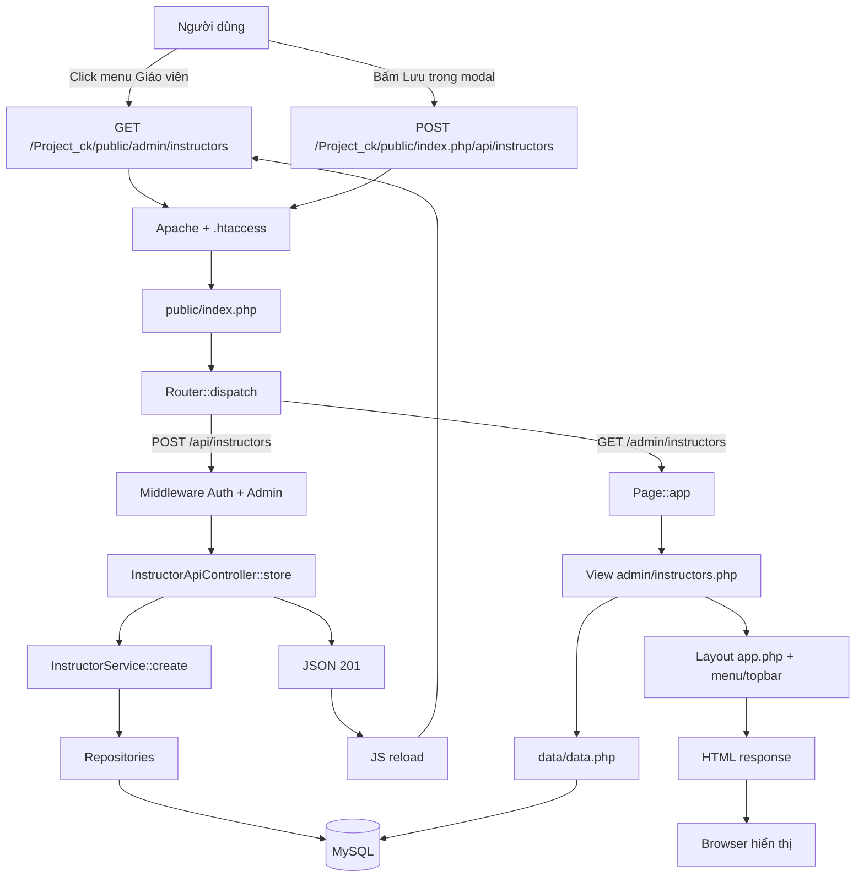

# Workflow tổng hợp: người dùng mở một trang (GET) và tạo giáo viên (POST)

Tài liệu này gộp toàn bộ luồng vào một chỗ, giải thích **từ lúc người dùng click** cho đến khi:

- **GET**: trình duyệt hiển thị trang `/admin/instructors`.
- **POST**: dữ liệu giáo viên được ghi vào MySQL và trang tải lại.

Mỗi bước đều có: dữ liệu thực tế đang là gì → code nào chạy → cú pháp PHP đó nghĩa là gì → vì sao viết như vậy.

---

## 0. Đọc nhanh: hai luồng trong một hình



Điểm cốt lõi:

```text
Mọi request đều đi qua public/index.php.
index.php chỉ làm 3 việc: nạp route, chạy Router, để Router gọi đúng hàm.
GET thường gọi Page::app() để render HTML.
POST thường gọi Controller API để ghi DB rồi trả JSON.
```

---

## 1. Nền tảng: request và response

### 1.1. Trình duyệt không biết PHP

Trình duyệt chỉ gửi một **HTTP request**:

```http
GET /Project_ck/public/admin/instructors HTTP/1.1
Host: localhost
Cookie: pt_session=abc123
```

hoặc:

```http
POST /Project_ck/public/index.php/api/instructors HTTP/1.1
Host: localhost
Content-Type: application/json
Cookie: pt_session=abc123

{"ten_dang_nhap":"gvmoi","mat_khau":"123456", ...}
```

Server trả **HTTP response**:

```http
HTTP/1.1 200 OK
Content-Type: text/html; charset=utf-8

<!DOCTYPE html>...
```

hoặc:

```http
HTTP/1.1 201 Created
Content-Type: application/json; charset=utf-8

{"success":true,"message":"Đã tạo giáo viên.","data":{"id":6}}
```

### 1.2. GET và POST khác nhau ở đâu

| | GET | POST |
| --- | --- | --- |
| Mục đích | Lấy dữ liệu / mở trang | Gửi dữ liệu / tạo mới |
| Dữ liệu | Trên URL (`?q=abc`) | Trong body |
| Có làm thay đổi DB? | Không | Có |
| Trong dự án | `/admin/instructors` | `/api/instructors` |

Cùng một URL có thể có cả GET và POST; Router phân biệt bằng **method**.

---

## 2. Tầng 1 — Apache và `.htaccess`

### 2.1. Apache tìm file thật

DocumentRoot của XAMPP là:

```text
C:/xampp/htdocs
```

Với URL:

```text
http://localhost/Project_ck/public/admin/instructors
```

Apache ghép:

```text
C:/xampp/htdocs/Project_ck/public/admin/instructors
```

Không có file/thư mục này → Apache xét `.htaccess` trong `public/`.

### 2.2. `public/.htaccess`

```apache
RewriteEngine On

RewriteCond %{REQUEST_FILENAME} !-f
RewriteCond %{REQUEST_FILENAME} !-d
RewriteRule ^ index.php [QSA,L]
```

Dịch từng dòng:

| Dòng | Nghĩa |
| --- | --- |
| `RewriteEngine On` | Bật rewrite |
| `%{REQUEST_FILENAME}` | Đường dẫn file thật đang xét |
| `!-f` | Không phải file tồn tại |
| `!-d` | Không phải thư mục tồn tại |
| `RewriteRule ^ index.php` | Mọi URL khớp → thay bằng `index.php` |
| `[QSA]` | Giữ query string |
| `[L]` | Dừng rule |

Kết quả: Apache chạy `public/index.php`, nhưng **URL trên thanh địa chỉ không đổi**. Đây gọi là **rewrite nội bộ**, khác với redirect (redirect bảo trình duyệt gọi URL mới).

### 2.3. PHP nhận được gì?

Sau rewrite, PHP thấy:

```php
$_SERVER['REQUEST_METHOD'] = 'GET';
$_SERVER['REQUEST_URI']    = '/Project_ck/public/admin/instructors';
$_SERVER['SCRIPT_NAME']    = '/Project_ck/public/index.php';
```

Với API gọi trực tiếp:

```php
$_SERVER['REQUEST_METHOD'] = 'POST';
$_SERVER['REQUEST_URI']    = '/Project_ck/public/index.php/api/instructors';
$_SERVER['SCRIPT_NAME']    = '/Project_ck/public/index.php';
```

**Điểm quan trọng:** `REQUEST_URI` là URL gốc người dùng gọi; `SCRIPT_NAME` là file PHP thực sự chạy. Router dùng cả hai để chuẩn hóa path.

### 2.4. `.htaccess` phụ ở gốc `htdocs`

Ngoài repo có `C:\xampp\htdocs\.htaccess`:

```apache
RewriteEngine On
RewriteRule ^api(/.*)?$ Project_ck/public/index.php [L,QSA]
RewriteRule ^index\.php(/.*)?$ Project_ck/public/index.php [L,QSA]
```

Cho phép gọi tắt `http://localhost/api/...` hoặc `http://localhost/index.php/api/...`. Lúc này `REQUEST_URI` là `/api/...` (không có tiền tố dự án), Router xử lý bình thường.

### 2.5. Vì sao có lúc 404 trước khi vào PHP?

- `htdocs/index.php` không tồn tại → gọi `http://localhost/index.php/...` bị Apache 404.
- `.htaccess` sai thư mục.
- `mod_rewrite` chưa bật.
- `AllowOverride` không cho phép.
- Gọi sai domain/port.

404 của Apache khác 404 của Router:

- Apache 404: trang HTML mặc định "The requested URL was not found on this server".
- Router 404: JSON `{"success":false,"message":"Không tìm thấy endpoint."}` hoặc HTML `<h1>404 - Không tìm thấy</h1>`.

---

## 3. Tầng 2 — `public/index.php`

File này chạy cho **mọi** request (trừ file tĩnh như CSS/JS vì chúng tồn tại thật, `.htaccess` bỏ qua).

### 3.1. Nạp autoload

```php
require __DIR__ . '/../src/bootstrap.php';
```

`bootstrap.php` đăng ký autoloader:

```php
spl_autoload_register(function (string $className): void {
    $prefix  = 'App\\';
    $baseDir = __DIR__ . '/';

    $relative = substr($className, strlen($prefix));
    $file = $baseDir . str_replace('\\', '/', $relative) . '.php';

    if (is_file($file)) {
        require $file;
    }
});
```

Khi code gọi `new InstructorService(...)`, PHP tự tìm:

```text
App\Services\InstructorService
→ src/Services/InstructorService.php
```

Không cần viết `require` cho từng class.

### 3.2. Mở session

```php
Session::start();
```

- Đọc cookie `pt_session` do trình duyệt gửi.
- Nạp `$_SESSION`.
- Nếu chưa có thì tạo session mới và gửi `Set-Cookie` về.

Session giữ `$_SESSION['tai_khoan_id']` sau khi đăng nhập. Nhờ đó các request sau biết ai đang đăng nhập.

### 3.3. Tạo Router

```php
$router = new Router();
```

Router lúc này có mảng `$routes = []` rỗng.

### 3.4. Kết nối DB và bootstrap dữ liệu

```php
$db = null;
try {
    $dbConfig = require __DIR__ . '/../mysql/config.php';
    // thử kết nối
    $db = require __DIR__ . '/../mysql/connect_mysql.php';

    require_once __DIR__ . '/../mysql/schema.php';
    require_once __DIR__ . '/../mysql/seed_accounts.php';
    ensure_schema($db);
    seed_initial_accounts($db);
} catch (Throwable $e) {
    $db = null;
}
```

- `ensure_schema()` tạo bảng nếu chưa có.
- `seed_initial_accounts()` tạo tài khoản mẫu nếu thiếu.
- Nếu DB lỗi → `$db = null`.

### 3.5. Đăng ký route

Các route **trang** (GET):

```php
$router->add('GET', '/admin/instructors', function (): void {
    Page::app('admin', 'admin/instructors', [], [
        'title' => 'Quản lý giáo viên',
        'active' => 'instructors',
        'breadcrumbs' => [['Quản trị', '/admin'], ['Giáo viên']],
        'scripts' => ['admin-instructors.js'],
    ]);
});
```

Các route **API** (chỉ đăng ký khi DB OK):

```php
if ($db !== null) {
    $taiKhoanRepo = new TaiKhoanRepository($db);
    $auth = new Auth($taiKhoanRepo);
    $authController = new AuthController($auth);

    $instructorRepo = new InstructorRepository($db);
    $instructorService = new InstructorService($instructorRepo, $taiKhoanRepo);
    $instructorController = new InstructorApiController($instructorService);

    $requireAuth = function () use ($auth): void {
        if (!$auth->check()) {
            Response::json(['success' => false, 'message' => 'Chưa đăng nhập.'], 401);
        }
    };

    $requireAdmin = function () use ($auth): void {
        if (!$auth->isAdmin()) {
            Response::json(['success' => false, 'message' => 'Bạn không có quyền thực hiện.'], 403);
        }
    };

    $router->add('POST', '/api/instructors', [$instructorController, 'store'], [$requireAuth, $requireAdmin]);
}
```

**Vì sao route API nằm trong `if ($db !== null)`?** Vì không có DB thì không thể xử lý. Nếu DB lỗi, route không tồn tại → Router trả 404.

### 3.6. Chạy Router

```php
$router->dispatch($_SERVER['REQUEST_METHOD'], $_SERVER['REQUEST_URI']);
```

Đây là điểm bắt đầu "phân loại route".

---

## 4. Tầng 3 — Router lọc route như thế nào

File: `src/Core/Router.php`.

### 4.1. Hai tham số đầu vào

```php
dispatch(string $method, string $uri)
```

- `$method` = `'GET'` hoặc `'POST'`...
- `$uri` = `'/Project_ck/public/index.php/api/instructors'` (có thể kèm query).

### 4.2. Chuẩn hóa path — 4 bước

```php
$path = parse_url($uri, PHP_URL_PATH) ?? '/';
```

Bỏ query string:

```text
/api/instructors?page=2 → /api/instructors
```

```php
$base = rtrim(str_replace('\\', '/', dirname($_SERVER['SCRIPT_NAME'] ?? '')), '/');
```

Lấy thư mục chứa `index.php`:

```text
SCRIPT_NAME = /Project_ck/public/index.php
dirname     = /Project_ck/public
```

```php
if ($base !== '' && strncmp($path, $base, strlen($base)) === 0) {
    $path = substr($path, strlen($base));
}
```

Cắt tiền tố dự án:

```text
/Project_ck/public/index.php/api/instructors
→ /index.php/api/instructors
```

```php
if (strncmp($path, '/index.php', 10) === 0) {
    $path = substr($path, 10);
}
if ($path === '') {
    $path = '/';
}
```

Cắt `/index.php` (10 ký tự):

```text
/index.php/api/instructors → /api/instructors
```

Kết quả cuối: một path sạch như `/api/instructors` hoặc `/admin/instructors`.

### 4.3. Lặp qua bảng route

```php
foreach ($this->routes as [$m, $p, $handler, $middleware]) {
```

`$this->routes` là mảng các mảng 4 phần tử:

```php
[
    ['GET',  '/admin/instructors', closure, []],
    ['POST', '/api/instructors',   [$controller, 'store'], [$requireAuth, $requireAdmin]],
    ['GET',  '/api/instructors',   [$controller, 'index'], [$requireAuth]],
    ['GET',  '/api/instructors/{id}', [$controller, 'show'], [$requireAuth]],
]
```

Cú pháp `as [$m, $p, $handler, $middleware]` là **destructuring**: gán 4 phần tử vào 4 biến, tương đương:

```php
foreach ($this->routes as $route) {
    $m = $route[0];
    $p = $route[1];
    $handler = $route[2];
    $middleware = $route[3];
}
```

### 4.4. Lọc theo method

```php
if ($m !== $method) {
    continue;
}
```

Request POST bỏ qua mọi route GET. Request GET bỏ qua route POST.

`!==` là so sánh chặt: khác kiểu hoặc khác giá trị đều đúng.

### 4.5. So khớp path — hàm `match()`

```php
private function match(string $route, string $path): ?array
{
    $routeParts = explode('/', trim($route, '/'));
    $pathParts  = explode('/', trim($path, '/'));

    if (count($routeParts) !== count($pathParts)) {
        return null;
    }

    $params = [];
    foreach ($routeParts as $i => $part) {
        if (preg_match('#^\{.+\}$#', $part)) {
            $params[] = $pathParts[$i];
        } elseif ($part !== $pathParts[$i]) {
            return null;
        }
    }

    return $params;
}
```

Ví dụ route `/api/instructors/{id}` và path `/api/instructors/5`:

| Bước | Kết quả |
| --- | --- |
| `trim('/', ...)` | `api/instructors/{id}` và `api/instructors/5` |
| `explode('/')` | `['api','instructors','{id}']` và `['api','instructors','5']` |
| `count` | 3 = 3 → tiếp |
| i=0 | `'api' === 'api'` |
| i=1 | `'instructors' === 'instructors'` |
| i=2 | `'{id}'` khớp regex → `$params = ['5']` |
| return | `['5']` |

Regex `#^\{.+\}$#`:

- `#` dấu phân cách
- `^` bắt đầu
- `\{` ký tự `{`
- `.+` một hay nhiều ký tự
- `\}` ký tự `}`
- `$` kết thúc

Nghĩa là "đoạn này là tham số động".

Ví dụ route tĩnh `/api/instructors` và path `/api/instructors`:

```php
$routeParts = ['api', 'instructors']; // 2
$pathParts  = ['api', 'instructors']; // 2
// các đoạn giống nhau, không có {id}
return []; // mảng rỗng = KHỚP
```

**Cực kỳ quan trọng:**

```php
if ($params !== null) { ... }
```

`[]` là khớp (route tĩnh), `null` là không khớp. Nếu viết `if ($params)` thì `[]` bị coi là false → route tĩnh không bao giờ chạy.

### 4.6. Chạy middleware

```php
foreach ($middleware as $mw) {
    $mw();
}
```

Với POST:

1. `$requireAuth()` → chưa đăng nhập thì `Response::json(..., 401)` và `exit`.
2. `$requireAdmin()` → không phải admin thì `Response::json(..., 403)` và `exit`.

Nếu qua cả hai → gọi handler.

### 4.7. Gọi handler

```php
call_user_func($handler, ...$params);
```

- `$handler = [$controller, 'store']` → gọi `$controller->store()`.
- `$params = ['5']` → gọi `$controller->show('5')`.

`call_user_func` cần thiết vì handler có thể là closure hoặc mảng object + method.

### 4.8. Không khớp route nào

```php
http_response_code(404);

if (strncmp($path, '/api/', 5) === 0 || $path === '/api') {
    header('Content-Type: application/json; charset=utf-8');
    echo json_encode(['success' => false, 'message' => 'Không tìm thấy endpoint.']);
    return;
}

header('Content-Type: text/html; charset=utf-8');
echo '<h1>404 - Không tìm thấy</h1>';
```

- `/api/...` → JSON 404.
- Còn lại → HTML 404.

---

# PHẦN A — LUỒNG GET: mở trang quản lý giáo viên

## A.1. Người dùng click

Trong sidebar có link:

```html
<a href="/Project_ck/public/admin/instructors">Giáo viên</a>
```

Trình duyệt gửi:

```http
GET /Project_ck/public/admin/instructors HTTP/1.1
Host: localhost
Cookie: pt_session=abc123
```

Đây là **GET**: chỉ mở trang, không gửi body.

## A.2. Apache xử lý

1. Ghép DocumentRoot + path → `C:/xampp/htdocs/Project_ck/public/admin/instructors`.
2. Không có file/thư mục đó.
3. `public/.htaccess` rewrite về `index.php`.
4. Chạy `public/index.php`.

PHP nhận:

```php
$_SERVER['REQUEST_METHOD'] = 'GET';
$_SERVER['REQUEST_URI']    = '/Project_ck/public/admin/instructors';
$_SERVER['SCRIPT_NAME']    = '/Project_ck/public/index.php';
```

## A.3. `index.php` nạp và dispatch

- Autoload + session.
- Tạo Router.
- Đăng ký toàn bộ route, trong đó có:

```php
$router->add('GET', '/admin/instructors', function (): void {
    Page::app('admin', 'admin/instructors', [], [
        'title' => 'Quản lý giáo viên',
        'active' => 'instructors',
        'breadcrumbs' => [['Quản trị', '/admin'], ['Giáo viên']],
        'scripts' => ['admin-instructors.js'],
    ]);
});
```

- Gọi `dispatch('GET', '/Project_ck/public/admin/instructors')`.

## A.4. Router chuẩn hóa và khớp

| Bước | Giá trị |
| --- | --- |
| `parse_url` | `/Project_ck/public/admin/instructors` |
| `$base` | `/Project_ck/public` |
| Cắt base | `/admin/instructors` |
| Cắt `/index.php` | không có gì để cắt |
| Method | `GET` khớp route GET |
| `match('/admin/instructors', '/admin/instructors')` | `[]` |
| Middleware | `[]` (trang không gắn middleware) |
| Handler | closure |

**Lưu ý quan trọng:** route trang `/admin/instructors` **không có** `requireAuth`/`requireAdmin`. Vì đây là đồ án demo, trang vẫn render khi chưa đăng nhập. Nếu muốn bắt buộc đăng nhập, thêm middleware vào route:

```php
$router->add('GET', '/admin/instructors', function (): void { ... }, [$requireAuth, $requireAdmin]);
```

Nhưng `$requireAuth` chỉ tồn tại khi DB OK, nên phải đặt route trong khối `if ($db !== null)`.

## A.5. Closure gọi `Page::app()`

```php
Page::app('admin', 'admin/instructors', [], [...]);
```

`Page::app` là **static method** (gọi bằng `::`, không cần `new`).

Nó nhận:

- `$role = 'admin'` → layout biết đang ở khu vực admin.
- `$view = 'admin/instructors'` → file view cần render.
- `$data = []` → biến truyền vào view.
- `$meta` → title, menu active, breadcrumb, script cần nạp.

## A.6. `Page::app` render view

File: `src/Core/Page.php`

```php
public static function app(string $role, string $view, array $data = [], array $meta = []): void
{
    $content = self::capture($view, $data);
    $pageTitle = (string) ($meta['title'] ?? 'FitZone');
    $activeMenu = (string) ($meta['active'] ?? '');
    $breadcrumbs = (array) ($meta['breadcrumbs'] ?? []);
    $pageActions = (string) ($meta['actions'] ?? '');
    $pageScripts = (array) ($meta['scripts'] ?? []);
    $appRole = $role;

    require __DIR__ . '/../Views/layouts/app.php';
}
```

### `capture()` làm gì?

```php
private static function capture(string $view, array $data): string
{
    require_once __DIR__ . '/../Views/components/ui.php';

    $file = __DIR__ . '/../Views/' . $view . '.php';

    extract($data, EXTR_SKIP);
    ob_start();
    require $file;

    return (string) ob_get_clean();
}
```

Giải thích cú pháp:

| Cú pháp | Nghĩa |
| --- | --- |
| `require_once` | Nạp file 1 lần |
| `extract($data, EXTR_SKIP)` | Biến key mảng thành biến PHP: `['x'=>1]` → `$x = 1` |
| `ob_start()` | Bắt đầu bộ đệm output |
| `require $file` | Chạy view; HTML được ghi vào bộ đệm thay vì gửi ra ngay |
| `ob_get_clean()` | Lấy nội dung bộ đệm và tắt bộ đệm |

Nhờ output buffering, view được render thành **chuỗi HTML** lưu vào `$content`, sau đó layout mới ghép vào.

## A.7. View truy vấn dữ liệu

File: `src/Views/admin/instructors.php`

```php
<?php
require_once __DIR__ . '/../data/data.php';

$instructors = data_instructors();
$active = count(array_filter($instructors, static fn ($i) => $i['status'] === 'hoat_dong'));
$classes = data_classes();
$openClasses = count(array_filter($classes, static fn ($c) => $c['status'] === 'dang_mo'));
$studentCount = count(array_unique(array_column(data_class_registrations(), 'member')));
$pendingSlots = count(array_filter(data_availability(), static fn ($r) => $r['status'] === 'cho_duyet'));
?>
```

### `data_instructors()` chạy SQL gì?

File: `src/Views/data/data.php`

```php
function data_instructors(): array
{
    $sql = "
        SELECT gv.id, gv.ho_ten AS name, gv.sdt AS phone, gv.email, gv.chuyen_mon AS specialty,
               (SELECT COUNT(*) FROM lop_hoc lh WHERE lh.giao_vien_id = gv.id AND lh.deleted_at IS NULL) AS classes,
               (SELECT COUNT(DISTINCT dkl.hoi_vien_id)
                  FROM dang_ky_lop dkl
                  JOIN lop_hoc lh2 ON lh2.id = dkl.lop_hoc_id
                 WHERE lh2.giao_vien_id = gv.id AND dkl.trang_thai = 'dang_ky') AS students,
               CASE gv.trang_thai WHEN 'dang_lam' THEN 'hoat_dong' ELSE 'ngung_hoat_dong' END AS status,
               COALESCE(tk.ten_dang_nhap, '—') AS account
        FROM giao_vien gv
        LEFT JOIN tai_khoan tk ON tk.id = gv.tai_khoan_id
        WHERE gv.deleted_at IS NULL
        ORDER BY gv.id
    ";
    return view_cast_ints(view_db()->query($sql)->fetch_all(MYSQLI_ASSOC), ['id', 'classes', 'students']);
}
```

Cú pháp đáng chú ý:

- `AS name`, `AS phone`... đổi tên cột trong kết quả cho view dễ dùng.
- `LEFT JOIN` lấy cả giáo viên chưa có tài khoản (`ten_dang_nhap = null`).
- `COALESCE(..., '—')` thay null bằng chuỗi.
- `fetch_all(MYSQLI_ASSOC)` trả mảng các dòng, mỗi dòng là mảng kết hợp.
- `view_cast_ints(...)` ép các cột số về `int` (MySQL trả chuỗi).

View sau đó dùng:

```php
<div class="stat-value"><?= count($instructors) ?></div>
```

`<?=` là in ra; `count()` đếm phần tử.

Lặp danh sách:

```php
<?php foreach ($instructors as $instructor): ?>
    <h2><?= e($instructor['name']) ?></h2>
<?php endforeach; ?>
```

- `foreach` duyệt mảng.
- `e()` là helper escape HTML, chống XSS.
- Cú pháp `foreach (...): ... endforeach;` là bản thay thế của `{ ... }`, tiện khi trộn HTML.

## A.8. Layout ghép trang

Sau khi có `$content`, `Page::app` nạp:

```php
require __DIR__ . '/../Views/layouts/app.php';
```

Layout này:

```php
require_once __DIR__ . '/../components/ui.php';
require_once __DIR__ . '/../data/data.php';
require_once __DIR__ . '/../partials/menu.php';

$user = app_user($appRole);
$notifications = app_notifications($appRole);
```

Rồi in:

```php
<?php require __DIR__ . '/../partials/sidebar.php'; ?>
<?php require __DIR__ . '/../partials/topbar.php'; ?>
<main class="app-content" id="main-content">
    <?= $content ?>
</main>
```

- `app_user()` lấy tên/email từ session + DB.
- `app_notifications()` đếm dữ liệu thật từ DB.
- `sidebar.php` dùng `app_menu($appRole)` để vẽ menu.
- `<?= $content ?>` chèn HTML của view vào giữa layout.

**Đây là lúc HTML hoàn chỉnh được tạo ra.** Chưa có gì gửi về trình duyệt cho đến khi PHP kết thúc (trừ khi có `echo` sớm).

## A.9. PHP gửi response

Sau khi layout chạy xong, toàn bộ HTML nằm trong output. Apache gửi:

```http
HTTP/1.1 200 OK
Content-Type: text/html; charset=utf-8

<!DOCTYPE html>
<html>...
```

Trình duyệt nhận và bắt đầu render.

## A.10. Trình duyệt tải CSS/JS

Trong HTML có:

```html
<link rel="stylesheet" href="/Project_ck/public/assets/css/app.css">
<script src="/Project_ck/public/assets/js/api.js?v=4"></script>
<script src="/Project_ck/public/assets/js/ui.js"></script>
<script src="/Project_ck/public/assets/js/pages/admin-instructors.js?v=3"></script>
```

Trình duyệt gửi thêm request cho từng file. Vì các file **tồn tại thật**, `.htaccess` có điều kiện `!-f` nên **không rewrite**, Apache trả file trực tiếp (nhanh, không qua PHP).

Đây là lý do CSS/JS vẫn tải bình thường dù mọi URL trang đều đi qua `index.php`.

## A.11. JS gắn sự kiện

`admin-instructors.js` chạy sau khi HTML tải xong:

- Tìm `#instructor-form`.
- Gắn sự kiện `submit`.
- Gắn sự kiện click cho nút sửa/xóa.
- Chuẩn bị modal Bootstrap.

Lúc này trang đã sẵn sàng. Người dùng bấm "Thêm giáo viên" → mở modal → nhập liệu → bấm "Lưu" → chuyển sang luồng POST.

## A.12. Bảng trace GET

| Bước | Dữ liệu |
| --- | --- |
| URL | `/Project_ck/public/admin/instructors` |
| Method | `GET` |
| Apache | Không thấy file → `.htaccess` → `index.php` |
| `SCRIPT_NAME` | `/Project_ck/public/index.php` |
| `REQUEST_URI` | `/Project_ck/public/admin/instructors` |
| Sau cắt base | `/admin/instructors` |
| Route khớp | `GET /admin/instructors` |
| Handler | closure → `Page::app(...)` |
| View | `src/Views/admin/instructors.php` |
| Dữ liệu | `data_instructors()` + `data_classes()` + ... |
| Layout | `app.php` + sidebar + topbar |
| Response | HTML 200 |
| Sau đó | Browser tải CSS/JS, JS gắn event |

---

# PHẦN B — LUỒNG POST: tạo giáo viên

## B.1. Người dùng bấm Lưu

Trong modal (view `admin/instructors.php`):

```html
<form id="instructor-form">
    <input id="if-name" name="ho_ten" required>
    <input id="if-phone" name="sdt" required>
    <input id="if-email" name="email" required>
    <input id="if-specialty" name="chuyen_mon">
    <input id="if-username" name="ten_dang_nhap" required>
    <input id="if-password" name="mat_khau" type="password">
    <textarea id="if-desc" name="mo_ta"></textarea>
</form>
```

Người dùng bấm nút `type="submit"` → trình duyệt phát sự kiện `submit`.

## B.2. JS chặn submit mặc định

File: `public/assets/js/pages/admin-instructors.js`

```js
form.addEventListener('submit', async function (event) {
    event.preventDefault();
    ...
});
```

`preventDefault()` chặn hành vi mặc định (gửi form và reload trang). Ta muốn gửi bằng `fetch` để nhận JSON.

### Vì sao dùng `async/await`?

```js
const response = await window.api.post('/api/instructors', payload);
```

`await` đợi Promise hoàn thành. Code bên dưới chỉ chạy khi server trả lời.

## B.3. JS đóng gói payload

```js
const payload = {
    ho_ten: fields.ho_ten.value.trim(),
    sdt: fields.sdt.value.trim(),
    email: fields.email.value.trim(),
    chuyen_mon: fields.chuyen_mon.value.trim(),
    gioi_thieu: fields.gioi_thieu.value.trim(),
    trang_thai: 'dang_lam'
};

const id = idInput.value.trim();

if (id) {
    if (password.value) payload.mat_khau = password.value;
    await window.api.put('/api/instructors/' + id, payload);
} else {
    payload.ten_dang_nhap = username.value.trim();
    payload.mat_khau = password.value;
    await window.api.post('/api/instructors', payload);
}
```

- `#if-id` rỗng → tạo mới → POST.
- Có id → sửa → PUT.
- `.trim()` bỏ khoảng trắng.
- Payload là object JS, sẽ được `JSON.stringify` trong `api.js`.

## B.4. `api.js` gửi request

File: `public/assets/js/api.js`

```js
const config = {
    base: (window.APP_BASE || '') + '/index.php'
};

async function request(method, path, body) {
    const headers = { Accept: 'application/json' };
    let payload;

    if (body !== undefined && body !== null) {
        headers['Content-Type'] = 'application/json';
        payload = JSON.stringify(body);
    }

    const response = await fetch(config.base + path, {
        method: method,
        headers: headers,
        body: payload,
        credentials: 'same-origin'
    });

    const json = await response.json();

    if (response.status === 401) { ... }
    if (!response.ok) {
        throw Object.assign(new Error(json.message), { status: response.status, data: json });
    }

    return json;
}
```

- `config.base` = `/Project_ck/public/index.php`.
- `path` = `/api/instructors`.
- URL cuối = `/Project_ck/public/index.php/api/instructors`.
- `credentials: 'same-origin'` gửi cookie session.
- `response.ok` false khi status không phải 2xx.
- `throw` đưa lỗi về `catch` trong `admin-instructors.js`.

## B.5. Apache nhận POST

Request:

```http
POST /Project_ck/public/index.php/api/instructors HTTP/1.1
Content-Type: application/json
Cookie: pt_session=abc123
```

Apache thấy `index.php` là file thật → chạy trực tiếp, phần `/api/instructors` là PATH_INFO.

## B.6. `index.php` và Router

- Autoload, session.
- DB OK → đăng ký route POST.
- `dispatch('POST', '/Project_ck/public/index.php/api/instructors')`.

Chuẩn hóa:

```text
/Project_ck/public/index.php/api/instructors
→ /index.php/api/instructors
→ /api/instructors
```

Lọc route:

- Route `GET /admin/instructors` bị bỏ (khác method).
- Route `POST /api/instructors` khớp method.
- `match('/api/instructors', '/api/instructors')` → `[]`.
- Vì `[] !== null` → khớp.

## B.7. Middleware

```php
foreach ($middleware as $mw) {
    $mw();
}
```

Thứ tự: `$requireAuth` → `$requireAdmin`.

### `$requireAuth`

```php
$requireAuth = function () use ($auth): void {
    if (!$auth->check()) {
        Response::json(['success' => false, 'message' => 'Chưa đăng nhập.'], 401);
    }
};
```

`Auth::check()`:

1. Đọc `$_SESSION['tai_khoan_id']`.
2. Nếu không có → `null`.
3. Nếu có → `TaiKhoanRepository::find($id)` truy vấn DB.
4. Trả `true` nếu tài khoản tồn tại và `trang_thai = 1`.

### `$requireAdmin`

```php
$requireAdmin = function () use ($auth): void {
    if (!$auth->isAdmin()) {
        Response::json(['success' => false, 'message' => 'Bạn không có quyền thực hiện.'], 403);
    }
};
```

`Auth::isAdmin()` kiểm tra `vai_tro === 'admin'`.

Nếu chưa đăng nhập → 401 và `exit`. Nếu không phải admin → 403 và `exit`. Chỉ khi qua cả hai mới gọi Controller.

## B.8. Controller nhận request

```php
public function store(): void
{
    $this->write('create');
}
```

`write()`:

```php
private function write(string $operation, ?int $id = null): void
{
    $input = Request::json();

    try {
        $result = $this->instructorService->create($input);
    } catch (\Throwable $e) {
        error_log('[api/instructors] ' . $e->getMessage());
        Response::json([...], 500);
    }

    if (!$result['ok']) {
        Response::json([...], 422);
    }

    Response::json([...], 201);
}
```

### `Request::json()`

```php
$contentType = $_SERVER['CONTENT_TYPE'] ?? '';
if (stripos($contentType, 'application/json') !== 0) {
    Response::json([...], 415);
}

$raw = file_get_contents('php://input');
$data = json_decode($raw, true, 512, JSON_THROW_ON_ERROR);
```

- `$_SERVER['CONTENT_TYPE']` do Apache đặt từ header.
- `stripos` tìm chuỗi không phân biệt hoa thường.
- `php://input` là body thô.
- `json_decode(..., true)` → mảng kết hợp.
- `JSON_THROW_ON_ERROR` → JSON sai sẽ ném exception.

## B.9. Service xử lý nghiệp vụ

File: `src/Services/InstructorService.php`

### 9.1. Normalize

```php
'ho_ten' => trim((string) ($input['ho_ten'] ?? $input['name'] ?? '')),
```

Đọc: lấy `ho_ten`, không có thì `name`, không có thì `''`; ép string; trim.

### 9.2. Validate

```php
if (mb_strlen($data['ho_ten']) < 2 || mb_strlen($data['ho_ten']) > 100) {
    $errors['ho_ten'] = 'Họ tên phải từ 2 đến 100 ký tự.';
}
```

- `$errors` là mảng `field => message`.
- `mb_strlen` đếm ký tự Unicode (tiếng Việt).
- `||` là hoặc.

Các kiểm tra khác: email bằng `filter_var`, username bằng `preg_match`, mật khẩu 6–72.

### 9.3. Kiểm tra trùng

```php
if (!$errors && $this->instructorRepository->emailExists($data['email'])) {
    $errors['email'] = 'Email đã được dùng.';
}
if (!$errors && $this->taiKhoanRepository->existsByUsername($data['ten_dang_nhap'])) {
    $errors['ten_dang_nhap'] = 'Tên đăng nhập đã tồn tại.';
}
```

`&&` là và. Chỉ kiểm tra trùng khi chưa có lỗi trước đó.

### 9.4. Tạo tài khoản

```php
$taiKhoanId = $this->taiKhoanRepository->insert([
    'ten_dang_nhap' => $data['ten_dang_nhap'],
    'mat_khau'      => password_hash($data['mat_khau'], PASSWORD_DEFAULT),
    'ho_ten'        => $data['ho_ten'],
    'vai_tro'       => 'instructor',
    'trang_thai'    => 1,
]);
```

`password_hash` tạo hash một chiều. `insert` trả id vừa tạo.

### 9.5. Tạo hồ sơ

```php
$id = $this->instructorRepository->save(new GiaoVien(
    null,
    $taiKhoanId,
    $data['ho_ten'],
    $data['sdt'],
    $data['email'],
    $data['chuyen_mon'],
    $data['gioi_thieu'],
    $data['trang_thai']
));
```

`new GiaoVien(...)` tạo object model, truyền tham số theo đúng thứ tự constructor.

### 9.6. Rollback nếu lỗi

```php
try {
    $id = $this->instructorRepository->save(...);
} catch (\Throwable $e) {
    $this->taiKhoanRepository->delete($taiKhoanId);
    throw $e;
}
```

Nếu tạo hồ sơ lỗi, xóa tài khoản vừa tạo để tránh dữ liệu mồ côi.

## B.10. Repository ghi SQL

`BaseRepository::insert`:

```php
$columns      = array_keys($data);
$colList      = implode(', ', array_map(fn($c) => "`$c`", $columns));
$placeholders = implode(', ', array_fill(0, count($columns), '?'));

$sql  = "INSERT INTO `{$this->table}` ($colList) VALUES ($placeholders)";
$stmt = $this->db->prepare($sql);

$values = array_values($data);
$types  = $this->detectTypes($values);
$stmt->bind_param($types, ...$values);
$stmt->execute();

$newId = $this->db->insert_id;
$stmt->close();

return $newId;
```

### Vì sao dùng `?`?

Chống SQL Injection. Giá trị người dùng không được nối trực tiếp vào SQL.

### `bind_param` và tham chiếu

```php
$stmt->bind_param('s', $tenDangNhap);
```

Tham số thứ 2 trở đi truyền **theo tham chiếu**, nên phải là biến. Không được:

```php
$stmt->bind_param('s', 'hoangnam'); // lỗi cannot be passed by reference
```

Trong `insert`, `...$values` trải mảng, mỗi phần tử là biến → hợp lệ.

### Kiểu dữ liệu

- `s` = string
- `i` = integer
- `d` = double/float

`detectTypes()` dùng `match (true)` + `is_int`/`is_float` để chọn.

## B.11. Trả JSON

```php
Response::json([
    'success' => true,
    'message' => 'Đã tạo giáo viên.',
    'data'    => ['id' => $result['id']],
], 201);
```

`Response::json`:

```php
http_response_code($status);
header('Content-Type: application/json; charset=utf-8');
header('Cache-Control: no-store');
echo json_encode($payload, JSON_UNESCAPED_UNICODE);
exit;
```

- Đặt status 201 (Created).
- Đặt header JSON.
- In JSON.
- `exit` dừng toàn bộ, không chạy code sau.

## B.12. JS nhận kết quả

```js
if (id) {
    await window.api.put(...);
} else {
    await window.api.post(...);
}
modal.hide();
window.location.reload();
```

- Thành công → đóng modal → reload trang.
- Reload chính là một **GET** mới → quay lại Phần A.
- Trang mới sẽ gọi `data_instructors()` và thấy giáo viên vừa tạo.

Nếu lỗi:

```js
} catch (error) {
    const details = error.data && error.data.errors
        ? Object.values(error.data.errors).join(' ')
        : error.message;
    window.showToast('Không thể lưu giáo viên', details, 'danger');
}
```

`Object.values()` lấy các message trong object `errors` (ví dụ `{email: "...", mat_khau: "..."}`) và nối lại.

## B.13. Bảng trace POST

| Bước | Dữ liệu |
| --- | --- |
| Hành động | Submit form trong modal |
| JS | `preventDefault()` + tạo payload |
| URL | `/Project_ck/public/index.php/api/instructors` |
| Method | `POST` |
| Apache | File `index.php` tồn tại → chạy |
| Router | Cắt base + `/index.php` → `/api/instructors` |
| Method filter | Route GET bị bỏ, route POST khớp |
| `match` | 2 đoạn tĩnh giống → `[]` |
| Middleware | `requireAuth` OK, `requireAdmin` OK |
| Handler | `InstructorApiController::store()` |
| Body | `Request::json()` đọc JSON |
| Service | normalize → validate → check trùng |
| DB 1 | `INSERT INTO tai_khoan` → id |
| DB 2 | `INSERT INTO giao_vien` (kèm `tai_khoan_id`) |
| Response | JSON 201 + `exit` |
| JS | Đóng modal + reload |
| Reload | GET `/admin/instructors` → hiển thị dữ liệu mới |

---

## 5. GET và POST khác nhau ở đâu — bảng so sánh

| Tiêu chí | GET trang | POST tạo |
| --- | --- | --- |
| Ai kích hoạt | Click link | Submit form |
| Có JS? | Không bắt buộc | Có (fetch) |
| Dữ liệu gửi | Không/query | Body JSON |
| Route middleware | Thường không | `requireAuth` + `requireAdmin` |
| Handler | Closure → `Page::app` | `Controller::store` |
| Kết quả | HTML | JSON |
| Ghi DB? | Không | Có (2 bảng) |
| Sau đó | Browser render | JS reload (GET mới) |

---

## 6. Bảng mã lỗi thường gặp

| Mã | Nơi phát sinh | Cách kiểm tra |
| --- | --- | --- |
| 404 Apache | Sai URL/không có `.htaccess` | Kiểm tra URL, mod_rewrite, AllowOverride |
| 404 JSON | Router không khớp / DB null | Kiểm tra method, path, MySQL |
| 401 | `$requireAuth` | Đăng nhập admin |
| 403 | `$requireAdmin` | Tài khoản phải có `vai_tro = admin` |
| 415 | `Request::json` | Header `Content-Type: application/json` |
| 400 | JSON sai cú pháp | Kiểm tra body |
| 422 | Validate/trùng dữ liệu | Đọc `response.errors` |
| 500 | Exception/DB | Xem `apache/logs/error.log` |

---

## 7. Debug theo từng tầng

### 7.1. Tầng trình duyệt

DevTools → Network:

- Request URL đúng chưa?
- Method đúng chưa?
- Payload có đủ field?
- Status code?
- Response body?

### 7.2. Tầng Apache

- `httpd.conf`: `mod_rewrite` đã bật?
- `.htaccess` đúng thư mục?
- Log: `C:\xampp\apache\logs\error.log`.

### 7.3. Tầng PHP

Tạm thêm:

```php
error_log('PATH=' . $path);
error_log('METHOD=' . $method);
```

Xem log để biết Router nhận gì.

### 7.4. Tầng DB

```sql
SELECT * FROM tai_khoan ORDER BY id DESC LIMIT 5;
SELECT * FROM giao_vien ORDER BY id DESC LIMIT 5;
```

Kiểm tra `giao_vien.tai_khoan_id` có trỏ đúng `tai_khoan.id` không.

---

## 8. Cheat sheet cú pháp xuất hiện trong luồng

| Cú pháp | Nghĩa |
| --- | --- |
| `<?php ... ?>` | Khối PHP |
| `<?= $x ?>` | In giá trị |
| `$bien` | Biến |
| `'a' . 'b'` | Nối chuỗi |
| `"$a"` / `"{$obj->x}"` | Nội suy |
| `['k' => $v]` | Mảng kết hợp |
| `$a['k']` | Truy cập mảng |
| `$obj->method()` | Gọi method object |
| `Class::method()` | Gọi static |
| `new Class(...)` | Tạo object |
| `function f(...): type {}` | Hàm có kiểu trả về |
| `fn ($x) => ...` | Arrow function |
| `function () use ($x) {}` | Closure |
| `??` | Mặc định nếu null |
| `===` / `!==` | So sánh chặt |
| `!` `&&` `||` | Phủ định / và / hoặc |
| `foreach ($a as $k => $v)` | Duyệt mảng |
| `foreach ($a as [$x, $y])` | Destructuring |
| `array_map` / `array_filter` | Biến đổi / lọc |
| `array_column` / `array_sum` | Lấy cột / tính tổng |
| `array_keys` / `array_values` | Lấy key / value |
| `implode` / `explode` | Ghép / tách chuỗi |
| `array_fill` | Tạo mảng lặp |
| `trim` / `mb_strlen` | Cắt khoảng trắng / đếm ký tự |
| `filter_var` / `preg_match` | Validate / regex |
| `password_hash` / `password_verify` | Hash / kiểm tra mật khẩu |
| `strncmp` / `substr` / `strlen` | So đầu chuỗi / cắt / độ dài |
| `parse_url` / `dirname` / `rtrim` | Xử lý URL/path |
| `preg_match('#^\{.+\}$#', $p)` | Nhận diện `{id}` |
| `call_user_func($fn, ...$args)` | Gọi callable |
| `header()` / `http_response_code()` | Header / status |
| `json_decode` / `json_encode` | JSON ↔ PHP |
| `file_get_contents('php://input')` | Đọc body |
| `ob_start` / `ob_get_clean` | Bộ đệm output |
| `extract($data, EXTR_SKIP)` | Mảng → biến |
| `require` / `require_once` | Nạp file |
| `__DIR__` | Thư mục file hiện tại |
| `try/catch/throw` | Bắt/ném lỗi |
| `prepare` / `bind_param` / `execute` | Prepared statement |
| `fetch_assoc` / `fetch_all` | Lấy dòng |
| `insert_id` | Id vừa insert |
| `exit` | Dừng script |
| `?->` | Gọi nếu object không null |
| `?Type` | Kiểu có thể null |

---

## 9. Bản đồ file

| File | Vai trò trong luồng |
| --- | --- |
| `public/.htaccess` | Rewrite URL trang về `index.php` |
| `C:\xampp\htdocs\.htaccess` | Cho phép gọi tắt `/api/...` |
| `public/index.php` | Bootstrap, session, DB, khai báo route, dispatch |
| `src/Core/Router.php` | Chuẩn hóa path, lọc method/path, gọi handler |
| `src/Core/Page.php` | Render view vào layout |
| `src/Core/Request.php` | Đọc body JSON |
| `src/Core/Response.php` | Trả JSON + status + exit |
| `src/Core/Auth.php` | Kiểm tra session + quyền |
| `src/Core/Session.php` | Mở session an toàn |
| `src/Controllers/Api/InstructorApiController.php` | Nhận POST, gọi Service, trả JSON |
| `src/Services/InstructorService.php` | Validate, kiểm tra trùng, điều phối tạo |
| `src/Repositories/InstructorRepository.php` | SQL bảng `giao_vien` |
| `src/Repositories/TaiKhoanRepository.php` | SQL bảng `tai_khoan` |
| `src/Repositories/BaseRepository.php` | `insert/update/delete` dùng chung |
| `src/Models/GiaoVien.php` | Model hồ sơ giáo viên |
| `src/Views/admin/instructors.php` | HTML danh sách + form modal |
| `src/Views/data/data.php` | Truy vấn dữ liệu cho view |
| `src/Views/layouts/app.php` | Ghép layout + menu + topbar |
| `src/Views/partials/menu.php` | Menu và thông tin user |
| `public/assets/js/api.js` | Wrapper fetch |
| `public/assets/js/pages/admin-instructors.js` | Bắt submit, gọi API, reload |

---

## 10. Mô hình tư duy cuối cùng

```text
1. Người dùng click
   → trình duyệt gửi HTTP request (method + URL + body + cookie).

2. Apache
   → tìm file thật; nếu không có thì .htaccess rewrite về index.php.

3. index.php
   → autoload, session, DB, nạp bảng route.
   → gọi Router::dispatch(method, URI).

4. Router
   → cắt domain/query/thư mục dự án/index.php.
   → tách path thành mảng các đoạn.
   → lọc theo method.
   → so từng đoạn: tĩnh phải giống, {id} nhận giá trị.
   → chạy middleware.
   → gọi đúng handler.

5. GET
   → Page::app → view + data.php + layout → HTML → browser.
   → browser tải CSS/JS → JS gắn sự kiện.

6. POST
   → JS fetch JSON → Router → middleware → Controller
   → Service validate → Repository SQL → MySQL
   → Response JSON → JS reload → quay lại GET.
```

Nếu hiểu 6 bước này, bạn đọc được mọi endpoint khác trong dự án: chỉ cần tìm route tương ứng trong `public/index.php`, rồi đi theo Controller → Service → Repository.
